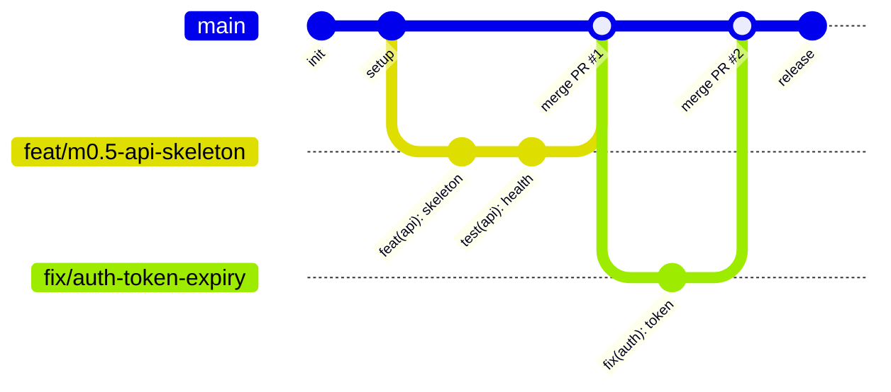

# Inveeta — Panduan Strategi Branching & Git Workflow

Dokumen ini mendefinisikan standar strategi branching dan alur kerja Git resmi untuk monorepo **Inveeta (`inveetabynrdz`)**, mengacu pada **Trunk-Based Development (TBD)** dan dokumentasi resmi **Turborepo** via Context7.

---

## 1. Fondasi: Trunk-Based Development (TBD)

Monorepo Inveeta menerapkan model **Trunk-Based Development** yang dirancang khusus untuk efisiensi tinggi, integrasi berkelanjutan (CI), dan pemanfaatan caching Turborepo:



### Prinsip Utama:
1. **Branch Utama (`main`)**:
   - Selalu stabil, lolos build/typecheck, dan *deployable* ke staging/production kapan saja (*always green*).
   - Seluruh perubahan digabungkan ke `main` melalui **Pull Request (PR)** atau squash merge setelah lulus verifikasi.
2. **Short-Lived Feature Branches**:
   - Dibuat langsung dari `main` terbaru (`git checkout -b <nama-branch> main`).
   - Berumur singkat (idealnya selesai dalam hitungan jam atau maksimal 1-2 hari per milestone/task).
   - Menghindari *long-lived branches* yang memicu merge conflict besar.

---

## 2. Standar Konvensi Penamaan Branch

Format penamaan branch menggunakan format terstruktur dengan prefiks tipe dan deskripsi kebab-case:

| Prefiks | Deskripsi | Contoh |
|---|---|---|
| `feat/` | Penambahan fitur baru atau penyelesaian task milestone | `feat/m0.5-api-skeleton`, `feat/rsvp-batch-service` |
| `fix/` | Perbaikan bug atau penanganan edge-case | `fix/guest-token-base64url`, `fix/sse-reconnect-jitter` |
| `refactor/` | Restrukturisasi kode tanpa mengubah fungsionalitas | `refactor/shared-date-formatter` |
| `chore/` | Pembaruan dependensi, konfigurasi CI, atau tooling | `chore/upgrade-turborepo-v2`, `chore/setup-docker` |
| `docs/` | Pembaruan dokumentasi atau panduan | `docs/update-architecture-diagram` |

---

## 3. Standar Pesan Commit (Conventional Commits)

Format pesan commit wajib mengikuti format:
```text
<tipe>(<cakupan>): <deskripsi ringkas dalam kalimat imperatif>
```

### Cakupan (*Scope*) Resmi di Inveeta:
- `root`: Konfigurasi root monorepo (`package.json`, `turbo.json`, `pnpm-workspace.yaml`).
- `shared`: Paket `@inveeta/shared`.
- `db`: Paket `@inveeta/db` dan skema Drizzle.
- `api`: Backend `apps/api` (Hono & Better Auth).
- `invitation`: Frontend `apps/invitation` (Next.js 15).
- `dashboard`: Frontend `apps/dashboard` (Vite PWA).
- `infra`: Docker, Caddy, CI/CD, atau deployment scripts.

### Contoh Commit:
- `feat(api): setup hono server and health check endpoint`
- `feat(db): add rsvps consistency check constraint`
- `fix(shared): prevent DOM/Node dependency in token generator`
- `chore(infra): add db:studio task to turbo pipeline`

---

## 4. Alur Kerja Praktis Harian (Daily Workflow)

```bash
# 1. Pastikan branch main selalu teranyar
git checkout main
git pull origin main

# 2. Buat branch fitur baru untuk task yang akan dikerjakan
git checkout -b feat/m0.5-api-skeleton

# 3. Lakukan pekerjaan, coding, dan commit teratur
git add .
git commit -m "feat(api): implement hono app skeleton and health endpoint"

# 4. Validasi kualitas kode monorepo secara lokal
pnpm turbo typecheck
pnpm turbo build

# 5. Push branch fitur ke remote GitHub
git push -u origin feat/m0.5-api-skeleton

# 6. Buat Pull Request (PR) di GitHub ke branch 'main'
#    Setelah di-review/diapprove, lakukan 'Squash and merge'
```

---

## 5. Integrasi Caching Turborepo (`--affected`)

Sesuai dokumentasi resmi Turborepo (Context7):
Saat menjalankan verifikasi di CI atau branch lokal, gunakan flag `--affected` untuk hanya menguji dan membangun paket yang terdampak oleh commit pada branch:

```bash
# Menjalankan typecheck hanya pada paket yang berubah relatif terhadap main
pnpm turbo typecheck --filter="...[origin/main]"

# Menjalankan build hanya pada paket yang berubah
pnpm turbo build --filter="...[origin/main]"
```
