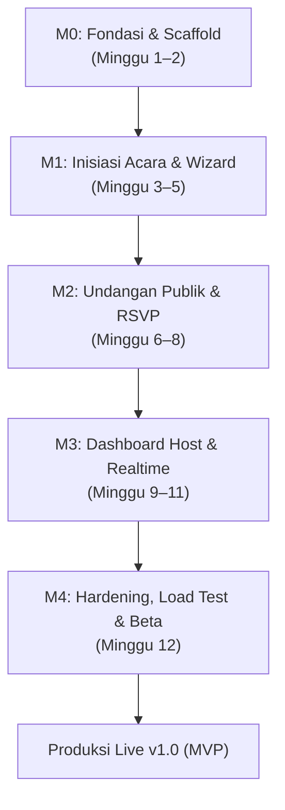

# Inveeta — Rencana Implementasi Teknis (Implementation Plan)

Dokumen ini memetakan milestone produk dari [docs/PRD.md](file:///c:/Users/Ridzuan/Documents/Naridza%20Studio/dev/inveetabynrdz/docs/PRD.md) dan spesifikasi arsitektur dari [docs/TDD.md](file:///c:/Users/Ridzuan/Documents/Naridza%20Studio/dev/inveetabynrdz/docs/TDD.md) ke dalam rincian tugas teknis (*actionable engineering tasks*), urutan dependensi antartugas (*critical path*), dan kriteria penyelesaian (*Definition of Done*) yang terukur untuk solo developer.

---

## 1. Peta Jalan & Garis Waktu Eksekusi (Roadmap Overview)

---

## 2. Rincian Milestone (M0 – M4)

### Milestone M0: Fondasi Monorepo, Database & Pipeline Deploy (Minggu 1–2)
> **Tujuan**: Membangun fondasi monorepo yang kokoh, skema database dasar, sistem autentikasi, dan pipeline deployment otomatis ke Vercel dan VPS.

#### Daftar Tugas Teknis:
1. **Scaffolding Monorepo & Tooling**:
   - [ ] Inisialisasi `pnpm-workspace.yaml` dan `turbo.json` dengan task pipeline `build`, `lint`, `typecheck`, `test`, `dev`.
   - [ ] Konfigurasi `tsconfig.base.json` dengan `strict: true` dan path alias monorepo (`@inveeta/*`).
   - [ ] Konfigurasi linter & formatter root monorepo.
2. **Paket Bersama (`packages/shared`)**:
   - [ ] Buat struktur direktori `schemas/`, `dto/`, `constants/`, `utils/`, `templates/`.
   - [ ] Tulis utilitas: `slugify()`, `formatEventDateTime()`, `normalizeWhatsAppNumber()`, `generateGuestToken()`, `generateId()`.
   - [ ] Tulis konstanta: `SYSTEM_LIMITS`, `RESERVED_SLUGS`, kategori tamu, status RSVP.
3. **Database & Migrasi Drizzle (`packages/db`)**:
   - [ ] Setup Drizzle ORM dengan driver `pg` / `node-postgres`.
   - [ ] Buat skema tabel autentikasi Better Auth (`users`, `sessions`, `accounts`, `verifications`).
   - [ ] Buat skema tabel domain (`events`, `event_sessions`, `guests`, `guest_session_allocations`, `rsvps`, `wishes`, `event_media`, `event_gift_details`, `wa_message_templates`).
   - [ ] Pasang `$defaultFn(() => generateId())` pada seluruh primary key dan daftarkan `eventsRelations` lengkap.
   - [ ] Buat migrasi SQL pertama via `pnpm db:generate`.
   - [ ] Buat script seed development (`packages/db/src/seeds/templates.ts` dan seed akun dummy).
4. **Backend API Skeleton (`apps/api`)**:
   - [ ] Setup server Hono di Node.js dengan middleware `corsMiddleware`, `securityHeadersMiddleware`, `globalErrorHandler`.
   - [ ] Integrasikan Better Auth dengan adapter Drizzle dan provider Email/Password + Google OAuth.
   - [ ] Pasang endpoint health check `GET /health` dengan probe liveness & readiness database.
   - [ ] Ekspor tipe gabungan `AppType` dari `apps/api/src/index.ts`.
5. **Infrastruktur & CI/CD**:
   - [ ] Buat `docker-compose.yml` untuk lingkungan VPS (layanan `caddy`, `api`, `postgres`).
   - [ ] Buat skrip migrasi container entrypoint (`apps/api/scripts/migrate.ts`) dengan `MIGRATIONS_DIR=/app/migrations`.
   - [ ] Setup pipeline GitHub Actions: linting, typecheck, testing, dan Turborepo remote caching.
   - [ ] Setup deployment perdana ke VPS (SSH remote pull) dan Vercel (2 project kosong).

#### Definition of Done (DoD) M0:
* Pipeline CI `pnpm turbo typecheck test build` sukses dengan *exit code 0*.
* Database PostgreSQL lokal dan VPS berhasil menjalankan migrasi SQL Drizzle tanpa error.
* Endpoint `https://api.inveeta.com/health` mengembalikan status `healthy` dan terhubung ke database.
* User berhasil registrasi dan login melalui Better Auth dan session cookie `.inveeta.com` tersimpan di browser.

---

### Milestone M1: Inisiasi Acara, Wizard & Media Storage (Minggu 3–5)
> **Tujuan**: Host dapat membuat akun, menyelesaikan wizard 5 langkah, mengunggah foto ke R2, dan mempublikasikan undangan dengan penguncian slug.

#### Daftar Tugas Teknis:
1. **Modul Media Cloudflare R2**:
   - [ ] Konfigurasi AWS S3 SDK Client untuk Cloudflare R2 di `apps/api/src/lib/r2.ts`.
   - [ ] Implementasi endpoint `POST /api/v1/manage/media/presign` dengan validasi ukuran file (foto $\le 2\text{ MB}$, audio $\le 10\text{ MB}$) dan kuota foto template.
   - [ ] Implementasi endpoint `POST /api/v1/manage/media/confirm` dengan verifikasi fisik file via S3 `HeadObjectCommand`.
   - [ ] Implementasi background job pembersihan file yatim (`pending_confirmation` $> 24\text{ jam}$).
2. **Template Registry (`packages/shared/src/templates`)**:
   - [ ] Definisikan 3 template default `free`: Minimalist Elegance, Rustic Garden, dan Javanese Heritage.
   - [ ] Tulis skema Zod `updateVisualCustomizationSchema` dan validasi section wajib.
3. **Backend Modul Acara & Wizard (`apps/api/src/modules/events`)**:
   - [ ] Implementasi pengecekan slug real-time: `GET /api/v1/public/events/:slug/check`.
   - [ ] Implementasi inisiasi draft: `POST /api/v1/manage/events/draft`.
   - [ ] Implementasi simpan progres bertahap: `PUT /api/v1/manage/events/:id/wizard-step`.
   - [ ] Implementasi finalisasi publikasi: `POST /api/v1/manage/events/:id/publish`.
   - [ ] Terapkan trigger PostgreSQL `trg_enforce_slug_immutability` di database.
   - [ ] Buat service webhook revalidasi Next.js ISR dengan 3x exponential backoff retry.
4. **Frontend Dashboard Wizard (`apps/dashboard`)**:
   - [ ] Setup Vite + React + Tailwind CSS + TanStack Query + React Router.
   - [ ] Buat antarmuka Wizard 5 Langkah:
     - Step 1: Info Dasar Acara & Usulan Slug (dengan availability indicator).
     - Step 2: Manajemen Sesi Acara (Akad, Resepsi, dll).
     - Step 3: Biodata Pengantin & Linimasa Kisah Cinta.
     - Step 4: Rekening Amplop Digital, QRIS & Unggah Galeri Foto (kompresi sisi klien via Canvas).
     - Step 5: Pemilihan Template, Palet Warna & Review Publikasi.
   - [ ] Modal konfirmasi finalisasi publikasi dengan peringatan penguncian slug permanen.

#### Definition of Done (DoD) M1:
* Host dapat menyelesaikan Wizard dari Step 1 hingga 5 dan menyimpan status draft kapan saja.
* Foto berhasil diunggah langsung ke Cloudflare R2 dan diverifikasi tanpa melalui bandwidth VPS.
* Begitu acara dipublikasikan, database menolak mutasi perubahan slug berikutnya.
* Acara terdaftar di dashboard Host dengan status live dan memiliki URL `https://inveeta.com/{slug}`.

---

### Milestone M2: Undangan Publik, Next.js ISR & RSVP Tamu (Minggu 6–8)
> **Tujuan**: Undangan publik dapat diakses dengan performa tinggi (LCP $\le 2.5\text{s}$), preview WhatsApp rapi, tamu personal dapat mengisi RSVP, dan mengirim ucapan.

#### Daftar Tugas Teknis:
1. **Frontend Undangan (`apps/invitation` - Next.js 15)**:
   - [ ] Konfigurasi Hono RPC client dengan pembungkus `React.cache()` dan tag caching Next.js 15 `{ tags: ['event-${slug}'], revalidate: 3600 }`.
   - [ ] Implementasi `generateMetadata()` di `app/[slug]/page.tsx` mengekspor Open Graph image statis R2 ($\le 300\text{ KB}$).
   - [ ] Buat route handler revalidasi internal: `POST /api/revalidate` dilindungi `x-revalidate-secret`.
   - [ ] Implementasi `TemplateRenderer` engine: merender seksi statis sesuai `sectionsOrder` dan menginjeksi CSS Variables warna tema.
2. **Arsitektur Islands & Komponen Dinamis**:
   - [ ] Buat komponen statis Server Components (Cover, Couple, Story, Sessions, Gallery, Gift).
   - [ ] Buat Client Island `BgmPlayerIsland` dengan penanganan interaksi pertama pemutar audio.
   - [ ] Buat Client Island `GuestGreetingIsland` yang membaca token dari segmen `/[slug]/[token]`.
   - [ ] Buat Client Island `RsvpInteractiveForm` dengan selektor kehadiran dan jumlah actualPax.
   - [ ] Buat Client Island `LiveWishesIsland` dengan infinite scroll cursor dan koneksi SSE.
3. **Backend RSVP & Buku Ucapan (`apps/api`)**:
   - [ ] Endpoint `GET /api/v1/public/events/:slug`: mengembalikan data shell publik (zero data tamu).
   - [ ] Endpoint `GET /api/v1/public/events/:slug/guests/:token`: mengembalikan konteks personal tamu & status override lock.
   - [ ] Endpoint `POST /api/v1/public/rsvp`: transaksi atomik PostgreSQL dengan `SELECT ... FOR UPDATE`, validasi `rsvpDeadline` zona waktu, validasi alokasi sesi, dan penegakan kuota pax.
   - [ ] Endpoint `GET /api/v1/public/wishes/:eventId`: paginasi cursor filter `is_hidden = false`.
   - [ ] Endpoint `POST /api/v1/public/wishes`: sanitasi teks anti-XSS via `sanitize-html`, rate limit 1/30s per IP, dan pemancaran event ke Event Bus.
4. **SSE Channel Hub (`apps/api/src/modules/realtime`)**:
   - [ ] Implementasi singleton `AppEventBus` dan `SSEChannelHub` dengan struktur map bertingkat $O(1)$.
   - [ ] Pasang endpoint streaming `GET /api/v1/realtime/events/:id/stream` dengan heartbeat 15s dan pemulihan `Last-Event-ID`.

#### Definition of Done (DoD) M2:
* Undangan publik `https://inveeta.com/{slug}` terbuka dengan LCP $\le 2.5\text{ detik}$ (Lighthouse Performance $\ge 90$).
* Kartu preview tautan di WhatsApp menampilkan gambar cover statis $\le 300\text{ KB}$ tanpa timeout.
* Tamu personal dapat membuka tautan personal `/{slug}/{token}`, melihat nama tersapa di amplop, mengisi RSVP, dan dicegah melebihi kuota pax.
* Tamu lain yang sedang membuka undangan melihat ucapan baru muncul secara instan via SSE tanpa reload halaman.

---

### Milestone M3: Dashboard Host PWA, Distribusi & Ekspor (Minggu 9–11)
> **Tujuan**: Host memiliki kontrol penuh di dashboard PWA: manajemen tamu, distribusi WhatsApp, manual override RSVP, moderasi ucapan, dan unduh laporan Excel.

#### Daftar Tugas Teknis:
1. **Fitur PWA & Offline Fallback (`apps/dashboard`)**:
   - [ ] Setup Service Worker via `vite-plugin-pwa` dengan `offline.html` fallback screen.
   - [ ] Konfigurasi Web App Manifest (nama aplikasi, icon 192x192 & 512x512, tema warna).
2. **Manajemen Tamu (`apps/dashboard/src/features/guests`)**:
   - [ ] Implementasi tabel tamu: pencarian nama, filter kategori (VIP/Keluarga/Reguler), dan filter status kehadiran.
   - [ ] Form entri tamu satuan: nama, nomor WhatsApp, kategori, kuota pax, centang alokasi sesi.
   - [ ] Pembangkitan otomatis token tamu CSPRNG 128-bit (22 karakter URL-safe).
   - [ ] Aksi edit dan hapus tamu (dengan konfirmasi kaskade RSVP).
3. **Override Manual & Moderasi**:
   - [ ] Modal Manual Override: Host dapat mengubah status RSVP dan pax tamu secara manual $\rightarrow$ memicu flag `is_manual_override = true` dan mengunci form tamu.
   - [ ] Tabel Moderasi Ucapan: Host dapat menyembunyikan (*hide*) ucapan yang tidak pantas atau menghapus permanen (*delete*).
4. **Distribusi Undangan WhatsApp**:
   - [ ] Editor template pesan WhatsApp dengan preview substitusi variabel `{nama}`, `{acara}`, `{tanggal}`, `{link}`.
   - [ ] Generator deep-link WhatsApp: tombol "Kirim via WhatsApp" (`wa.me`) dan "Salin Tautan Personal".
5. **Ekspor Data Rekap**:
   - [ ] Implementasi endpoint `GET /api/v1/manage/events/:id/export/xlsx` menggunakan `exceljs` in-memory buffer.
   - [ ] Implementasi endpoint `GET /api/v1/manage/events/:id/export/csv` menggunakan text streaming dengan UTF-8 BOM.
6. **Integrasi Metrik Realtime Dashboard**:
   - [ ] Komponen kartu ringkasan KPI (Total Diundang, Pax Hadir, Pax Tidak Hadir, Belum Konfirmasi).
   - [ ] Listener SSE di dashboard Host untuk memperbarui kartu metrik seketika saat ada tamu yang mengisi RSVP.

#### Definition of Done (DoD) M3:
* Host dapat menambahkan 100 tamu, mengalokasikan sesi berbeda, dan mengunduh rekap Excel dengan format kolom rapi.
* Host dapat mengubah RSVP tamu secara manual dan form tamu personal seketika terkunci (*read-only*).
* Tombol WhatsApp membuka aplikasi WhatsApp dengan pesan dan tautan personal yang terisi sempurna.
* Dashboard Host dapat diinstal di homescreen ponsel sebagai PWA dan menampilkan halaman offline saat sinyal terputus.

---

### Milestone M4: Hardening, Pengujian Beban & Peluncuran Beta (Minggu 12)
> **Tujuan**: Verifikasi keandalan sistem pada beban produksi, pengujian keamanan menyeluruh, audit performa, dan peluncuran beta untuk 3–5 acara pernikahan nyata.

#### Daftar Tugas Teknis:
1. **Pengujian Beban (*Load Testing*)**:
   - [ ] Jalankan skrip k6: simulasi 2.000 pembukaan undangan/jam puncak ke Vercel CDN (verifikasi hit rate $\ge 95\%$, latensi p95 $\le 300\text{ ms}$).
   - [ ] Jalankan skrip k6: simulasi 200 koneksi SSE berumur panjang simultan ke VPS Linux selama 30 menit (verifikasi RAM Node.js stabil $< 150\text{ MB}$).
2. **Audit Keamanan & Kepatuhan**:
   - [ ] Verifikasi uji penetrasi XSS pada input nama dan pesan buku ucapan.
   - [ ] Verifikasi pemblokiran brute-force slug via rate limiter (100 req/menit).
   - [ ] Uji coba penghapusan acara permanen untuk memvalidasi kepatuhan hak hapus UU PDP.
3. **Backup & Pemulihan Operasional**:
   - [ ] Uji coba otomatisasi cron script backup database PostgreSQL harian ke Cloudflare R2.
   - [ ] Jalankan uji restore database (*restore drill*) dari file dump ke database staging kosong.
4. **Peluncuran Beta Terbatas**:
   - [ ] Onboarding 3–5 pasangan pengantin nyata ke platform Inveeta.
   - [ ] Pantau log Sentry dan metrik server selama hari H pembagian undangan dan hari H resepsi.
   - [ ] Kumpulkan feedback pengguna dan selesaikan bug kritis sebelum peluncuran publik v1.0.

#### Definition of Done (DoD) M4:
* Seluruh kriteria beban (2.000 pembukaan undangan, 200 SSE) lolos pengujian tanpa error 500/504.
* Skrip backup database berjalan otomatis di VPS dan uji restore berhasil 100%.
* Zero critical bug di Sentry selama masa pengujian beta dengan pengguna nyata.
* Dokumentasi operasional dan runbook siap digunakan.

---

## 3. Matriks Ketergantungan Tugas (*Critical Path Dependency*)

| Tugas | Bergantung Pada | Dampak Jika Tertunda |
|---|---|---|
| **M1: Wizard Backend** | M0: Skema Database & Migrasi Drizzle | Pembangunan form dashboard tidak memiliki kontrak API. |
| **M1: Upload Media R2** | M0: Konfigurasi Secret & Cloudflare Bucket | Host tidak dapat menyimpan foto galeri pernikahan. |
| **M2: Next.js ISR Page** | M1: Finalisasi Acara & Endpoint Publik | Undangan tidak dapat dirender di Vercel. |
| **M2: Transaksi RSVP** | M0: Skema Tabel `rsvps` & Index Unik | Terjadi inkonsistensi data kuota kehadiran. |
| **M3: Manajemen Tamu** | M2: Token Tamu & Validasi Sesi | Host tidak dapat menyebarkan tautan undangan personal. |
| **M3: Ekspor Excel** | M3: Manajemen Tamu & Data RSVP | Host tidak dapat mengunduh daftar rekap untuk WO/katering. |
| **M4: Load Testing** | M2: Endpoint Publik & M2: SSE Hub | Performa produksi tidak terverifikasi sebelum hari H acara. |
