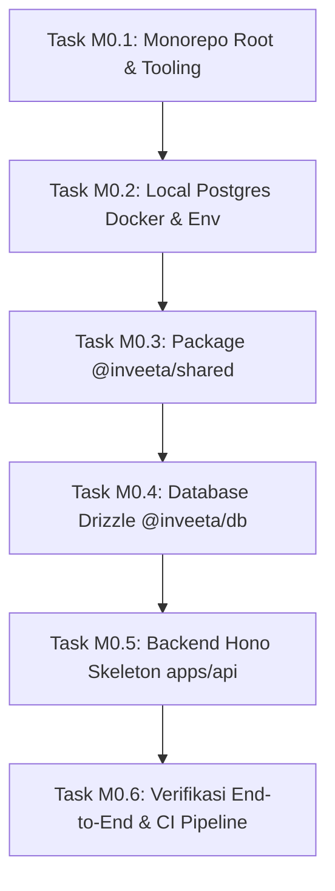

# Panduan Eksekusi Milestone M0 (Step-by-Step Prompt & Action Guide)

Dokumen ini adalah buku panduan operasional untuk mengeksekusi **Milestone M0: Fondasi Monorepo, Database & Tooling** dari [IMPLEMENTATION_PLAN.md](file:///c:/Users/Ridzuan/Documents/Naridza Studio/dev/inveetabynrdz/docs/IMPLEMENTATION_PLAN.md).

Panduan ini membagi M0 menjadi **6 Task Sekuensial**. Untuk tiap task, terdapat panduan apa yang perlu Anda lakukan secara manual, dan **Prompt Siap Pakai** yang dapat Anda berikan kepada Antigravity.

---

## Ringkasan Alur Eksekusi M0



---

## 🛠️ Task M0.1: Scaffolding Monorepo Root & Tooling

### 1. Tindakan Manual Anda:
- Tidak ada persiapan khusus. (Node.js v24 dan pnpm v10 sudah terpasang di sistem Anda).

### 2. Prompt untuk Antigravity:
```text
Jalankan Task M0.1: Inisialisasi Git dan Scaffolding Monorepo Root Inveeta.
Sesuai TDD Bagian 2 & 14:
1. Inisialisasi git repository (git init) dan buat file .gitignore standar monorepo Node.js/Turborepo.
2. Buat pnpm-workspace.yaml yang mencakup packages/* dan apps/*.
3. Buat root package.json dengan Turborepo v2, TypeScript v5, dan skrip monorepo: dev, build, lint, typecheck, test, clean.
4. Buat turbo.json sesuai spesifikasi TDD §14.3.A (termasuk REVALIDATION_SECRET, DATABASE_URL, dll).
5. Buat tsconfig.base.json dengan strict: true dan path mapping @inveeta/* ke packages/*.
6. Jalankan pnpm install awal untuk memvalidasi konfigurasi workspace.
```

### 3. Apa yang Dilakukan Antigravity:
- Menginisialisasi repositori Git lokal.
- Membuat konfigurasi workspace Turborepo + pnpm.
- Menginstal dependensi build tooling level root.

### 4. Kriteria Selesai (DoD M0.1):
- File `pnpm-lock.yaml`, `turbo.json`, `pnpm-workspace.yaml` terbuat.
- Perintah `pnpm turbo --version` dapat dieksekusi tanpa error.

---

## 🐘 Task M0.2: Lingkungan Basis Data Lokal (Docker Compose & Env)

### 1. Tindakan Manual Anda:
- Buka dan jalankan aplikasi **Docker Desktop** di Windows Anda.
- Pastikan engine Docker berstatus *running* (ikon hijau di pojok kiri bawah Docker Desktop).

### 2. Prompt untuk Antigravity:
```text
Jalankan Task M0.2: Setup Local Database Docker Compose dan Environment Template.
Sesuai TDD Bagian 14.1 & 14.2:
1. Buat docker-compose.yml di root untuk menjalankan container PostgreSQL 16 Alpine pada port 5432 (database: inveeta_dev, user: postgres, password: postgres) dengan persistent volume.
2. Buat file .env.example yang memuat seluruh variabel wajib dari TDD §14.2.
3. Buat file .env lokal berdasarkan template dengan kredensial PostgreSQL lokal.
4. Jalankan container postgres menggunakan docker compose up -d dan uji koneksi ketersediaan port 5432.
```

### 3. Apa yang Dilakukan Antigravity:
- Membuat file `docker-compose.yml` dan template environment `.env.example`.
- Menyalakan service database container dan memeriksa status *healthy*.

### 4. Kriteria Selesai (DoD M0.2):
- Container `inveeta-postgres` aktif berjalan di port `5432`.
- Database `inveeta_dev` siap menerima koneksi.

---

## 📦 Task M0.3: Paket Bersama `@inveeta/shared` (Schemas, DTO, Utils)

### 1. Tindakan Manual Anda:
- Tidak ada (100% di-generate oleh Antigravity).

### 2. Prompt untuk Antigravity:
```text
Jalankan Task M0.3: Implementasi Paket @inveeta/shared.
Sesuai TDD Bagian 5.3 & Bagian 12 serta aturan AGENTS.md:
1. Buat struktur folder packages/shared lengkap dengan package.json dan tsconfig.json.
2. Tulis konstanta di src/constants/: limits.ts, reservedSlugs.ts, categories.ts.
3. Tulis utilitas murni di src/utils/: id.ts (generateId), token.ts (generateGuestToken 128-bit), slugify.ts, dateFormat.ts (menggunakan IANA identifier Asia/Jakarta, Asia/Makassar, Asia/Jayapura), phone.ts.
4. Tulis skema Zod di src/schemas/:
   - event.schema.ts (dateTimeSchema dengan offset, visualCustomizationSchema, createDraftEventSchema)
   - guest.schema.ts (createGuestSchema, manualOverrideRsvpSchema)
   - rsvp.schema.ts (rsvpSessionItemSchema, submitRsvpSchema multi-sesi)
   - wish.schema.ts (createWishSchema)
   - media.schema.ts (presignMediaSchema)
5. Inferensikan tipe TypeScript DTO di src/dto/ dan ekspor entrypoint di src/index.ts.
6. Jalankan pnpm --filter @inveeta/shared build dan typecheck untuk memastikan nol error tipe.
```

### 3. Apa yang Dilakukan Antigravity:
- Membuat paket TypeScript murni tanpa dependensi Node/DOM/Database.
- Mengompilasi library dan memverifikasi type-safety.

### 4. Kriteria Selesai (DoD M0.3):
- `pnpm --filter @inveeta/shared typecheck` sukses (*exit code 0*).
- Paket siap diimpor oleh `@inveeta/db` dan `apps/api`.

---

## 🗄️ Task M0.4: Database & Migrasi Drizzle `@inveeta/db`

### 1. Tindakan Manual Anda:
- Pastikan Docker container PostgreSQL dari Task M0.2 masih berjalan.

### 2. Prompt untuk Antigravity:
```text
Jalankan Task M0.4: Setup Drizzle ORM, Skema Tabel, dan Migrasi SQL di packages/db.
Sesuai TDD Bagian 4.2 & AGENTS.md:
1. Buat packages/db dengan package.json, tsconfig.json, dan drizzle.config.ts mengarah ke migrations/.
2. Setup koneksi PostgreSQL di src/client.ts menggunakan pool 'pg'.
3. Buat skema modular di src/schemas/:
   - auth.ts: users, sessions, accounts, verifications (dengan .$defaultFn(() => generateId()) pada semua primary key).
   - events.ts: events, eventSessions, eventsRelations lengkap, eventSessionsRelations.
   - guests.ts: guests (termasuk checkedInAt & checkInSessionId), guestSessionAllocations, rsvps (dengan status_pax_consistency_check), guestsRelations.
   - contents.ts: wishes, eventMedia, eventGiftDetails, waMessageTemplates beserta relasinya.
4. Ekspor seluruh skema dan relasi di src/index.ts.
5. Jalankan perintah pnpm db:generate untuk membangkitkan file migrasi SQL pertama.
6. Jalankan pnpm db:migrate untuk mengeksekusi migrasi ke database PostgreSQL lokal dan verifikasi pembuatan tabel.
```

### 3. Apa yang Dilakukan Antigravity:
- Membuat skema tabel Drizzle ORM dengan semua foreign keys, unique indexes, dan check constraints.
- Membangkitkan file migrasi SQL di `packages/db/migrations/`.
- Menerapkan tabel ke database lokal.

### 4. Kriteria Selesai (DoD M0.4):
- Tabel `users`, `events`, `guests`, `rsvps`, dll. terbuat di database PostgreSQL.
- Migrasi Drizzle berjalan tanpa error.

---

## ⚡ Task M0.5: Backend API Skeleton `apps/api` (Hono, Better Auth & Health)

### 1. Tindakan Manual Anda (Opsional untuk Dev Lokal):
- Untuk pengujian Email/Password lokal, Anda tidak perlu kredensial pihak ketiga.
- Jika ingin menyiapkan Google OAuth nanti, buat OAuth 2.0 Client ID di Google Cloud Console, lalu isi `GOOGLE_CLIENT_ID` dan `GOOGLE_CLIENT_SECRET` di `.env`.

### 2. Prompt untuk Antigravity:
```text
Jalankan Task M0.5: Setup Backend Skeleton apps/api dengan Hono & Better Auth.
Sesuai TDD Bagian 3.2, Bagian 5, Bagian 6 & AGENTS.md:
1. Buat apps/api dengan package.json dan tsconfig.json.
2. Buat instance Better Auth di src/lib/auth.ts menggunakan drizzleAdapter(db), provider Email+Password, dan trustedOrigins (https://inveeta.com, https://app.inveeta.com, localhost).
3. Buat middleware: corsMiddleware, securityHeadersMiddleware, dan globalErrorHandler.
4. Buat router Hono utama di src/index.ts menggunakan pola method chaining yang mengekspor AppType:
   - Mount Better Auth handler di /api/auth/**.
   - Endpoint GET /health yang memeriksa liveness server dan readiness koneksi database (SELECT 1).
   - Buat kerangka rute untuk /api/v1/public/* dan /api/v1/manage/*.
5. Jalankan pnpm --filter @inveeta/api dev, uji request GET ke http://localhost:3000/health, dan verifikasi respons JSON 200 OK.
```

### 3. Apa yang Dilakukan Antigravity:
- Membangun struktur server Hono di Node.js.
- Mengintegrasikan Better Auth dengan tabel Drizzle PostgreSQL.
- Menguji endpoint `/health`.

### 4. Kriteria Selesai (DoD M0.5):
- Endpoint `http://localhost:3000/health` mengembalikan `{"status":"healthy","database":"connected"}`.
- Tipe `AppType` terekspor untuk konsumsi RPC di masa mendatang.

---

## 🚀 Task M0.6: Penutupan Milestone M0 & Pipeline CI/CD

### 1. Tindakan Manual Anda (Opsional):
- Buat repositori baru di akun GitHub Anda (misal: `github.com/[username]/inveetabynrdz`) jika ingin menghubungkan remote Git.

### 2. Prompt untuk Antigravity:
```text
Jalankan Task M0.6: Verifikasi Penuh Milestone M0 dan Setup GitHub Actions CI.
Sesuai TDD Bagian 14.3 & IMPLEMENTATION_PLAN.md:
1. Buat workflow GitHub Actions di .github/workflows/ci.yml untuk mengeksekusi pnpm turbo lint typecheck test build pada setiap push dan pull request.
2. Buat skrip seed dummy di packages/db/src/seeds/dev.ts untuk mengisi data template bawaan dan akun test.
3. Jalankan verifikasi menyeluruh di root monorepo:
   pnpm turbo typecheck
   pnpm turbo build
4. Pastikan seluruh pipeline berhasil dengan exit code 0 dan laporkan status penyelesaian Milestone M0.
```

### 3. Apa yang Dilakukan Antigravity:
- Menyiapkan otomatisasi pipeline CI GitHub Actions.
- Menguji typecheck dan build di seluruh monorepo.
- Memastikan tidak ada error tipe atau dependensi yang patah.

### 4. Kriteria Selesai (DoD M0.6 / Final Milestone M0):
- Seluruh paket dan aplikasi lulus typecheck.
- Milestone M0 selesai 100%, siap melangkah ke **Milestone M1 (Wizard Acara & R2 Storage)**.
