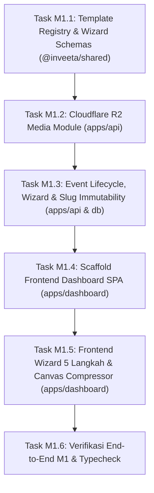

# Panduan Eksekusi Milestone M1 (Step-by-Step Prompt & Action Guide)

Dokumen ini adalah buku panduan operasional untuk mengeksekusi **Milestone M1: Inisiasi Acara, Wizard 5 Langkah & Media Storage** dari [IMPLEMENTATION_PLAN.md](file:///c:/Users/Ridzuan/Documents/Naridza Studio/dev/inveetabynrdz/inveeta/docs/IMPLEMENTATION_PLAN.md).

Panduan ini membagi M1 menjadi **6 Task Sekuensial**. Untuk tiap task, terdapat panduan apa yang perlu Anda lakukan secara manual, dan **Prompt Siap Pakai** yang dapat langsung Anda berikan kepada Antigravity.

---

## Ringkasan Alur Eksekusi M1



---

## 🎨 Task M1.1: Template Registry & Skema Wizard (`@inveeta/shared`)

### 1. Tindakan Manual Anda:
- **Tidak ada** (100% otomatis digenerate oleh Antigravity).

### 2. Prompt untuk Antigravity:
```text
Jalankan Task M1.1: Implementasi Template Registry dan Skema Validasi Wizard di packages/shared.
Sesuai PRD §3.2, TDD §5.3, §10, dan aturan AGENTS.md:
1. Buat direktori packages/shared/src/templates/registry/ dan definisikan 3 template bawaan paket 'free':
   - minimalist.ts ('minimalist-elegance', maxPhotos: 5, preset warna netral/monokrom, font: playfair-inter)
   - rustic.ts ('rustic-garden', maxPhotos: 5, preset warna earth-tone/sage, font: cormorant-montserrat)
   - heritage.ts ('javanese-heritage', maxPhotos: 5, preset warna emas/terracotta, font: cinzel-lato)
   - Daftarkan seluruh template di packages/shared/src/templates/registry/index.ts (TEMPLATE_REGISTRY, TEMPLATE_IDS, DEFAULT_TEMPLATE_ID).
2. Di packages/shared/src/schemas/event.schema.ts:
   - Definisikan updateWizardStepSchema yang memvalidasi payload per nomor langkah (Step 1 sampai 5).
   - Definisikan publishEventSchema ({ eventId }).
   - Definisikan updatePublishedEventSchema untuk mutasi parsial acara yang sudah live (dengan proteksi slug dilarang diubah).
3. Ekspor seluruh tipe baru di packages/shared/src/dto/event.dto.ts dan re-ekspor di packages/shared/src/index.ts.
4. Jalankan pnpm --filter @inveeta/shared build dan typecheck untuk memvalidasi nol error tipe.
```

### 3. Apa yang Dilakukan Antigravity:
- Membuat sistem registry template berbasis kode dengan konfigurasi layout, slot foto, dan palet warna.
- Menambahkan skema validasi Zod untuk setiap langkah formulir wizard (Step 1–5).
- Memverifikasi build paket `@inveeta/shared`.

### 4. Kriteria Selesai (DoD M1.1):
- `pnpm --filter @inveeta/shared typecheck` sukses dengan exit code 0.
- Registry template siap dikonsumsi oleh backend dan dashboard.

---

## ☁️ Task M1.2: Modul Media Cloudflare R2 (`apps/api`)

### 1. Tindakan Manual Anda:
- Anda memiliki 2 opsi:
  - **Opsi A (Cloudflare R2 Asli - Direkomendasikan & Gratis)**:
    1. Buka dashboard Cloudflare -> R2 -> Create bucket dengan nama `inveeta-storage`.
    2. Masuk ke *Manage R2 API Tokens* -> *Create API Token* (izin: *Object Read & Write*).
    3. Salin `Account ID`, `Access Key ID`, dan `Secret Access Key`.
    4. Masukkan ke file `.env`:
       ```env
       R2_ACCOUNT_ID="your-cloudflare-account-id"
       R2_ACCESS_KEY_ID="your-r2-access-key-id"
       R2_SECRET_ACCESS_KEY="your-r2-secret-access-key"
       R2_BUCKET_NAME="inveeta-storage"
       R2_PUBLIC_URL="https://cdn.inveeta.com"
       ```
  - **Opsi B (Lokal / Dummy Dev Mode)**:
    Jika belum ingin membuat akun Cloudflare R2 sekarang, beri tahu Antigravity untuk menyertakan mock/fallback lokal di `apps/api` agar Anda tetap bisa lanjut coding tanpa hambatan!

### 2. Prompt untuk Antigravity:
```text
Jalankan Task M1.2: Implementasi Modul Media Cloudflare R2 dan Presign Endpoints di apps/api.
Sesuai TDD Bagian 9, Bagian 5.2.B.6, dan Aturan Kritis AGENTS.md (Jebakan 3):
1. Tambahkan dependensi AWS SDK v3 S3 client (@aws-sdk/client-s3, @aws-sdk/s3-request-presigner) di apps/api.
2. Buat client S3 di apps/api/src/lib/r2.ts yang dikonfigurasi ke endpoint Cloudflare R2 (https://<R2_ACCOUNT_ID>.r2.cloudflarestorage.com).
3. Buat service media di apps/api/src/modules/media/service.ts:
   - generatePresignedPutUrl(): Menerapkan TTL 10 menit, validasi batas ukuran (foto <= 2 MB, audio <= 10 MB), dan membentuk key terstruktur 'events/{eventId}/{folder}/{uuid}.{ext}'.
   - confirmMediaUpload(): Mengeksekusi HeadObjectCommand ke R2 untuk memverifikasi file fisik benar-benar ada dan ukuran sesuai, lalu menyimpan metadata ke tabel event_media PostgreSQL.
   - deleteMedia(): Menghapus objek fisik di R2 via DeleteObjectCommand dan menghapus baris di event_media.
4. Buat sub-router Hono di apps/api/src/modules/media/routes.ts dengan prefix /api/v1/manage/media:
   - POST /presign (dilindungi requireAuth)
   - POST /confirm (dilindungi requireAuth)
   - DELETE /:mediaId (dilindungi requireAuth)
5. Pasangkan route media ke app di apps/api/src/index.ts menggunakan method chaining.
6. Buat skrip background cleanup file yatim di apps/api/src/jobs/cleanupOrphanMedia.ts.
7. Jalankan typecheck monorepo untuk memastikan tidak ada error.
```

### 3. Apa yang Dilakukan Antigravity:
- Mengintegrasikan AWS S3 Client untuk R2.
- Membuat endpoint penandatanganan presigned PUT URL dan endpoint konfirmasi upload.
- Memastikan aturan keamanan tanda tangan kriptografis S3 dipatuhi.

### 4. Kriteria Selesai (DoD M1.2):
- Endpoint `POST /api/v1/manage/media/presign` dan `POST /api/v1/manage/media/confirm` aktif.
- Typecheck monorepo lolos 100%.

---

## 💍 Task M1.3: Event Lifecycle, Wizard & Slug Immutability (`apps/api` & `packages/db`)

### 1. Tindakan Manual Anda:
- Pastikan Docker container PostgreSQL masih berjalan di komputer Anda.

### 2. Prompt untuk Antigravity:
```text
Jalankan Task M1.3: Implementasi Siklus Hidup Acara, Wizard Multi-Step, dan Trigger Penguncian Slug.
Sesuai TDD §4.3.A, §5.2.A.2, §5.2.B, §7.2.B, dan AGENTS.md:
1. Di packages/db:
   - Buat migrasi SQL untuk trigger PostgreSQL 'trg_enforce_slug_immutability' pada tabel events (mencegah update kolom slug jika is_published = true).
   - Jalankan migrasi ke PostgreSQL lokal via pnpm db:migrate.
2. Di apps/api/src/services/revalidation.ts:
   - Implementasikan fungsi triggerNextRevalidate(slug) yang memanggil webhook Next.js ISR dengan shared secret REVALIDATION_SECRET dan retry 3x exponential backoff.
3. Di apps/api/src/modules/events/:
   - Service events.service.ts:
     * checkSlugAvailability(slug): Mengecek reservedSlugs dan query ke database.
     * createDraftEvent(hostId, input): Membuat acara baru dengan status is_published = false.
     * updateWizardStep(hostId, eventId, step, data): Memperbarui sesi, pengantin, gift, atau visual sesuai step.
     * publishEvent(hostId, eventId): Validasi prasyarat publikasi (min 1 sesi, nama pengantin, tanggal, batas RSVP), set is_published = true, dan trigger webhook revalidasi.
     * getEventById(hostId, eventId) & getHostEvents(hostId).
   - Sub-router Hono events.routes.ts:
     * GET /api/v1/public/events/:slug/check (Publik)
     * GET /api/v1/manage/events/mine (Auth)
     * GET /api/v1/manage/events/:id (Auth + Owner Guard)
     * POST /api/v1/manage/events/draft (Auth)
     * PUT /api/v1/manage/events/:id/wizard-step (Auth + Owner Guard)
     * POST /api/v1/manage/events/:id/publish (Auth + Owner Guard)
4. Mount sub-router ke apps/api/src/index.ts menggunakan method chaining.
5. Jalankan pnpm turbo typecheck untuk memvalidasi tipe RPC Hono.
```

### 3. Apa yang Dilakukan Antigravity:
- Membuat logika pembuatan draft acara bertahap dan validasi prasyarat publikasi.
- Menambahkan proteksi trigger PostgreSQL agar slug yang sudah terbit terkunci permanen.
- Menghubungkan service revalidasi Next.js on-demand ISR.

### 4. Kriteria Selesai (DoD M1.3):
- Endpoint pengecekan slug dan inisiasi draft acara berhasil merespons.
- Trigger database menolak mutasi slug pada acara berstatus published.

---

## 💻 Task M1.4: Scaffolding Frontend Dashboard SPA (`apps/dashboard`)

### 1. Tindakan Manual Anda:
- **Tidak ada** (100% otomatis digenerate oleh Antigravity).

### 2. Prompt untuk Antigravity:
```text
Jalankan Task M1.4: Setup Scaffolding Frontend Dashboard (apps/dashboard) dengan Vite + React + Tailwind CSS.
Sesuai TDD Bagian 3.4 & Bagian 6:
1. Inisialisasi apps/dashboard sebagai React 18/19 SPA menggunakan Vite, TypeScript, dan Tailwind CSS.
2. Pasang dependensi utama: @tanstack/react-query, react-router-dom, better-auth/react, lucide-react, clsx, tailwind-merge.
3. Konfigurasi lib frontend:
   - src/lib/auth-client.ts: Inisialisasi createAuthClient dari Better Auth dengan baseURL API.
   - src/lib/api-client.ts: Inisialisasi Hono RPC client (hc<AppType>) mengarah ke VITE_API_URL dengan credentials: 'include'.
   - src/lib/query-client.ts: QueryClient TanStack Query dengan default staleTime 1 menit.
4. Buat layout dasar dashboard:
   - Header / Navbar dengan status profil user dan tombol logout.
   - ProtectedRoute wrapper yang mengarahkan user unauthenticated ke halaman login.
5. Buat halaman otentikasi sederhana: Login / Register (Email & Password) di src/pages/auth/.
6. Hubungkan apps/dashboard ke root workspace dan pastikan pnpm turbo build typecheck lulus tanpa error.
```

### 3. Apa yang Dilakukan Antigravity:
- Mengonfigurasi aplikasi Vite React SPA dalam monorepo Turborepo.
- Menyiapkan Hono RPC Client bertipe statis langsung dari backend `apps/api`.
- Menyiapkan autentikasi Better Auth client.

### 4. Kriteria Selesai (DoD M1.4):
- Aplikasi `apps/dashboard` dapat dijalankan via `pnpm --filter @inveeta/dashboard dev` di `http://localhost:5173`.
- Halaman login dan dashboard layout dasar tampil rapi.

---

## 🪄 Task M1.5: Frontend Wizard 5 Langkah & Canvas Pre-Compressor (`apps/dashboard`)

### 1. Tindakan Manual Anda:
- Siapkan beberapa file foto pernikahan dummy di komputer Anda (JPEG/PNG berukuran apa saja) untuk menguji fitur kompresi Canvas dan upload.

### 2. Prompt untuk Antigravity:
```text
Jalankan Task M1.5: Implementasi Antarmuka Wizard Pembuatan Acara 5 Langkah dan Kompresi Foto di apps/dashboard.
Sesuai PRD §3.2, TDD §9.3.B, §11.1, dan Aturan Kritis AGENTS.md (Jebakan 3):
1. Buat utilitas kompresi gambar di src/utils/imageCompressor.ts menggunakan HTML5 Canvas:
   - Resize otomatis ke lebar maksimal 1920px (menjaga rasio aspek).
   - Konversi format ke 'image/webp' dengan kualitas 85% (target <= 600 KB).
   - Menghasilkan Blob dan mengembalikan mimeType 'image/webp' secara eksplisit.
2. Buat fungsi upload presigned di src/services/mediaUpload.ts:
   - Meminta presigned URL via API POST /api/v1/manage/media/presign.
   - Mengunggah file via fetch(uploadUrl, { method: 'PUT', headers: { 'Content-Type': presignResult.mimeType }, body: compressedBlob }) (WAJIB header Content-Type identik mutlak anti 403 Signature error).
   - Memanggil POST /api/v1/manage/media/confirm untuk menyimpan ke database.
3. Buat komponen Wizard 5 Langkah di src/pages/wizard/:
   - WizardContainer: State management multi-step, navigasi Back/Next, indikator progres 1-5, dan auto-save draft.
   - Step 1 (Info Dasar): Judul acara, pemilih tanggal/jam, zona waktu IANA, input usulan slug dengan live availability check debounce 500ms.
   - Step 2 (Sesi Acara): Tambah/ubah sesi (Akad Nikah, Resepsi), waktu mulai/selesai, nama lokasi, alamat, Google Maps URL.
   - Step 3 (Biodata & Cerita): Profil mempelai pria & wanita, nama orang tua, kutipan romantis, linimasa cerita cinta.
   - Step 4 (Hadiah Digital & Foto): Form rekening bank/e-wallet, unggah gambar QRIS, unggah galeri foto (terintegrasi imageCompressor).
   - Step 5 (Template & Publikasi): Pemilihan template (Minimalist/Rustic/Heritage), pilihan tema warna, preview ringkasan.
4. Buat Modal Konfirmasi Publikasi: Peringatan tegas bahwa setelah dipublikasikan, tautan URL (slug) terkunci permanen dan tidak dapat diubah lagi.
5. Jalankan pnpm turbo typecheck untuk memvalidasi integrasi frontend-backend.
```

### 3. Apa yang Dilakukan Antigravity:
- Membangun antarmuka pengguna wizard interaktif langkah demi langkah.
- Mengimplementasikan kompresor foto WebP di browser berbasis HTML5 Canvas untuk menghemat bandwidth.
- Memastikan header `Content-Type` pada upload PUT S3 terkunci sempurna anti-error 403.
- Mengintegrasikan modal penguncian slug saat publikasi.

### 4. Kriteria Selesai (DoD M1.5):
- Host dapat mengisi Wizard dari Step 1 sampai Step 5 di browser `http://localhost:5173`.
- Foto terkompresi otomatis menjadi WebP sebelum diunggah.
- Tombol Publikasikan berhasil memicu endpoint `/publish` dan mengunci status acara.

---

## 🏆 Task M1.6: Verifikasi End-to-End M1 & Typecheck Monorepo

### 1. Tindakan Manual Anda:
- Buka browser dan lakukan pengujian alur lengkap pembuatan acara dari awal sampai publikasi.

### 2. Prompt untuk Antigravity:
```text
Jalankan Task M1.6: Pengujian dan Verifikasi Menyeluruh Milestone M1.
1. Jalankan pipeline verifikasi monorepo:
   pnpm turbo lint typecheck build
2. Uji endpoint backend:
   - Buat user test dan login.
   - Inisiasi draft acara via API / draft wizard.
   - Coba mutasi slug setelah acara berstatus is_published = true untuk membuktikan trigger PostgreSQL menolak perubahan (400 Bad Request / Trigger Exception).
3. Laporkan status pemenuhan Definition of Done (DoD) Milestone M1.
```

### 3. Apa yang Dilakukan Antigravity:
- Menjalankan static analysis dan TypeScript compiler di seluruh paket (`shared`, `db`, `api`, `dashboard`).
- Menguji skenario penguncian slug dan integritas penyimpanan data acara.

### 4. Kriteria Selesai (DoD M1.6 / Final Milestone M1):
* Host dapat menyelesaikan Wizard dari Step 1 hingga 5 dan menyimpan status draft kapan saja.
* Foto berhasil diunggah langsung ke storage dan diverifikasi.
* Begitu acara dipublikasikan, database menolak mutasi perubahan slug berikutnya.
* Acara terdaftar di dashboard Host dengan status live.
* Milestone M1 selesai 100%, siap melangkah ke **Milestone M2 (Undangan Publik Next.js 15 & RSVP Tamu)**!
