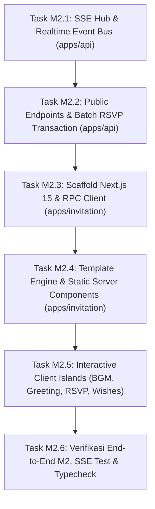

# Panduan Eksekusi Milestone M2 (Step-by-Step Prompt & Action Guide)

Dokumen ini adalah buku panduan operasional untuk mengeksekusi **Milestone M2: Undangan Publik, Next.js ISR & RSVP Tamu** dari [IMPLEMENTATION_PLAN.md](file:///c:/Users/Ridzuan/Documents/Naridza Studio/dev/inveetabynrdz/inveeta/docs/IMPLEMENTATION_PLAN.md).

Panduan ini membagi M2 menjadi **6 Task Sekuensial**. Untuk tiap task, terdapat panduan apa yang perlu Anda lakukan secara manual, dan **Prompt Siap Pakai** yang dapat langsung Anda berikan kepada Antigravity.

---

## Ringkasan Alur Eksekusi M2



---

## ⚡ Task M2.1: Event Bus Internal, SSE Channel Hub & Realtime Streaming (`apps/api`)

### 1. Tindakan Manual Anda:
- **Tidak ada** (100% otomatis digenerate oleh Antigravity).

### 2. Prompt untuk Antigravity:
```text
Jalankan Task M2.1: Implementasi Event Bus Internal dan SSE Channel Hub di apps/api.
Sesuai TDD Bagian 8 dan Aturan Kritis AGENTS.md (Jebakan 4):
1. Buat abstraksi Event Bus di apps/api/src/modules/realtime/bus.ts:
   - Singleton AppEventBus berbasis EventEmitter yang menangani event domain: 'wish.created', 'wish.moderated', 'wish.deleted', 'rsvp.updated', 'metrics.updated'.
2. Buat Channel Hub di apps/api/src/modules/realtime/hub.ts:
   - Singleton SSEChannelHub dengan Map bertingkat O(1): Map<eventId, Map<clientId, ReadableStreamDefaultController>>.
   - Metode subscribe(), unsubscribe(), dan broadcastEvent().
   - Auto-unsubscribe & cleanup memori saat stream klien terputus.
3. Buat sub-router SSE di apps/api/src/modules/realtime/routes.ts:
   - Endpoint GET /api/v1/realtime/events/:id/stream (Text/Event-Stream).
   - Heartbeat keep-alive ping setiap 15 detik (: ping\n\n) untuk mencegah socket timeout.
   - Mekanisme pemulihan data tertinggal via header Last-Event-ID atau query lastTimestamp dengan BATAS KERAS .limit(20) (Server Bounding anti thundering herd).
4. Mount rute realtime ke router utama apps/api/src/index.ts menggunakan method chaining.
5. Jalankan pnpm turbo typecheck untuk memvalidasi tipe.
```

### 3. Apa yang Dilakukan Antigravity:
- Membangun event hub in-memory untuk streaming realtime Server-Sent Events.
- Mengimplementasikan heartbeat keep-alive 15 detik.
- Mengamankan endpoint dari risiko lonjakan memori via query bounding `.limit(20)`.

### 4. Kriteria Selesai (DoD M2.1):
- Endpoint `GET /api/v1/realtime/events/:id/stream` dapat dihubungkan via curl / browser dan menerima ping berkala.
- Typecheck monorepo lolos dengan exit code 0.

---

## 📝 Task M2.2: Endpoint Publik: Batch RSVP, Ucapan & Konteks Tamu (`apps/api`)

### 1. Tindakan Manual Anda:
- Pastikan Docker container PostgreSQL masih berjalan di komputer Anda.

### 2. Prompt untuk Antigravity:
```text
Jalankan Task M2.2: Implementasi Endpoint Publik Acara, Batch Transaksi RSVP, dan Buku Ucapan di apps/api.
Sesuai TDD §4.3.B, §4.3.E, §5.2.A, §11.2, dan Aturan Kritis AGENTS.md (Jebakan 1):
1. Buat public events & guest context di apps/api/src/modules/public/events.routes.ts:
   - GET /api/v1/public/events/:slug: Mengembalikan PublicEventDTO lengkap (hanya sesi umum isPublic = true, zero data sensitif PII).
   - GET /api/v1/public/events/:slug/guests/:token: Mengembalikan PersonalizedGuestContextDTO (nama tamu, maxPax, alokasi sesi tamu, riwayat RSVP, dan isRsvpLocked). Menolak token palsu dengan 404 terstruktur.
2. Buat service dan route RSVP di apps/api/src/modules/public/rsvp.routes.ts:
   - POST /api/v1/public/rsvp: Menerima SubmitRsvpInput (sessions: [{ eventSessionId, status, actualPax }]).
   - Implementasikan transaksi atomik Drizzle di dalam db.transaction(async (tx) => { ... }):
     * Kunci baris tamu: SELECT ... FROM guests WHERE id = $guestId FOR UPDATE.
     * Evaluasi deadline acara: NOW() <= event.rsvpDeadline.
     * Looping for (const sessionItem of input.sessions): verifikasi alokasi di guestSessionAllocations, tolak jika isManualOverride = true, verifikasi actualPax <= guest.maxPax, dan upsert ke tabel rsvps.
     * Jika 1 sesi gagal, ROLLBACK total.
   - Pancarkan event 'rsvp.updated' ke AppEventBus setelah transaksi commit.
3. Buat service dan route buku ucapan di apps/api/src/modules/public/wishes.routes.ts:
   - GET /api/v1/public/wishes/:eventId: Cursor-based pagination (limit 20), hanya menampilkan ucapan yang WHERE is_hidden = false.
   - POST /api/v1/public/wishes: Sanitasi teks anti-XSS via sanitize-html (allowedTags: []), terapkan strict rate limiting (1 ucapan / 30 detik per IP), simpan ke tabel wishes, dan pancarkan event 'wish.created' ke AppEventBus.
4. Mount seluruh rute publik dengan prefix /api/v1/public di apps/api/src/index.ts menggunakan method chaining.
5. Jalankan pnpm turbo typecheck untuk memvalidasi tipe RPC Hono.
```

### 3. Apa yang Dilakukan Antigravity:
- Menyediakan endpoint data shell undangan publik yang aman dari kebocoran PII (UU PDP).
- Mengimplementasikan transaksi multi-sesi RSVP atomik dengan row lock `FOR UPDATE` (Jebakan 1).
- Menyediakan buku ucapan publik dengan sanitasi anti-XSS dan rate limit ketat anti-spam.

### 4. Kriteria Selesai (DoD M2.2):
- Endpoint `GET /api/v1/public/events/:slug` dan `POST /api/v1/public/rsvp` berfungsi sempurna.
- Ekspor `AppType` di `apps/api/src/index.ts` memuat seluruh skema rute publik baru.

---

## 🌐 Task M2.3: Scaffolding Frontend Undangan Next.js 15 (`apps/invitation`)

### 1. Tindakan Manual Anda:
- **Tidak ada** (100% otomatis digenerate oleh Antigravity).

### 2. Prompt untuk Antigravity:
```text
Jalankan Task M2.3: Setup Scaffolding Frontend Undangan (apps/invitation) dengan Next.js 15 App Router.
Sesuai TDD Bagian 3.3, §7.1, §7.2, §9.3.C, dan Aturan Kritis AGENTS.md:
1. Inisialisasi apps/invitation menggunakan Next.js 15 (App Router), TypeScript, dan Tailwind CSS.
2. Pasang dependensi monorepo: hono, @inveeta/shared, lucide-react, clsx, tailwind-merge, canvas-confetti.
3. Konfigurasi Client RPC di src/lib/api-client.ts:
   - Buat honoClient menggunakan hc<AppType>(API_BASE_URL).
   - Buat helper getCachedPublicEvent(slug) yang dibungkus React.cache() dengan fetch option:
     { cache: 'force-cache', next: { tags: [`events-${slug}`], revalidate: 3600 } }.
4. Buat custom image loader di src/lib/image-loader.ts untuk mengarahkan gambar R2 ke CDN Cloudflare cdn.inveeta.com dengan zero-egress.
5. Buat route handler revalidasi internal di src/app/api/revalidate/route.ts:
   - Menerima POST request berisi { tag: string }.
   - Memvalidasi header x-revalidate-secret terhadap process.env.REVALIDATION_SECRET.
   - Memanggil revalidateTag(tag) dari next/cache untuk menghapus cache on-demand.
6. Konfigurasi tsconfig.json dan hubungkan ke root workspace monorepo.
7. Jalankan pnpm turbo typecheck build untuk memvalidasi kompatibilitas Next.js 15.
```

### 3. Apa yang Dilakukan Antigravity:
- Mengonfigurasi Next.js 15 App Router dalam monorepo.
- Menyiapkan integrasi Hono RPC Client dengan strategi on-demand ISR tagged cache (`events-${slug}`).
- Membangun webhook revalidasi internal yang aman.

### 4. Kriteria Selesai (DoD M2.3):
- Server Next.js 15 dapat dijalankan via `pnpm --filter @inveeta/invitation dev` di port 3000 / 3001.
- Route `/api/revalidate` merespons 401 jika secret salah dan 200 jika secret valid.

---

## 🏛️ Task M2.4: Template Renderer Engine & Komponen Server Statis (`apps/invitation`)

### 1. Tindakan Manual Anda:
- **Tidak ada** (100% otomatis digenerate oleh Antigravity).

### 2. Prompt untuk Antigravity:
```text
Jalankan Task M2.4: Implementasi Template Engine dan Komponen Server Statis di apps/invitation.
Sesuai TDD §7.3, §7.4, §10.2, dan AGENTS.md:
1. Di src/components/static/: Buat komponen-komponen Server Components murni (0 KB client JavaScript bundle):
   - CoverSection.tsx: Banner foto utama, nama mempelai, tanggal acara, countdown statis.
   - CoupleSection.tsx: Profil mempelai pria dan wanita beserta nama orang tua.
   - QuoteSection.tsx: Ayat suci / kutipan cinta.
   - LoveStorySection.tsx: Linimasa cerita cinta perjalanan pasangan.
   - PublicSessions.tsx: Kartu sesi acara umum (Akad / Resepsi), alamat lengkap, tombol buka Google Maps & Waze.
   - PhotoGallery.tsx: Grid galeri foto pernikahan (menggunakan custom image loader).
   - DigitalGiftSection.tsx: Rekening bank dengan tombol salin dan QRIS amplop digital.
2. Di src/components/TemplateRenderer.tsx:
   - Injeksi CSS Variables warna tema (--color-primary, --color-secondary, --font-theme) ke elemen pembungkus root.
   - Render section secara dinamis berdasarkan event.visualCustomization.sectionsOrder dengan menyaring event.visualCustomization.hiddenSections.
3. Di src/app/[slug]/page.tsx:
   - Server Component utama untuk tautan publik umum.
   - Panggil getCachedPublicEvent(slug). Jika acara tidak ditemukan, render not-found screen ramah pengguna.
   - Implementasikan generateMetadata({ params }): Mengembalikan title, deskripsi, dan Open Graph WhatsApp yang merujuk langsung ke URL cover terkompresi R2 (event.ogImageUrl) tanpa dynamic opengraph-image.tsx.
4. Jalankan pnpm turbo typecheck untuk memvalidasi tipe komponen.
```

### 3. Apa yang Dilakukan Antigravity:
- Membangun markup HTML statis berkecepatan tinggi (LCP $\le 2.5\text{s}$).
- Menerapkan arsitektur zero-bundle-size pada komponen konten visual.
- Memastikan kartu pratinjau link WhatsApp tampil sempurna dengan metadata Open Graph.

### 4. Kriteria Selesai (DoD M2.4):
- Halaman publik `http://localhost:3001/[slug]` merender seluruh konten acara pernikahan dengan layout template yang rapi.
- HTML statis ter-render lengkap tanpa ketergantungan JavaScript browser.

---

## 🏝️ Task M2.5: Interactive Client Islands: BGM, Sapaan Tamu, RSVP & Live Wishes (`apps/invitation`)

### 1. Tindakan Manual Anda:
- Buka browser untuk menguji interaksi tombol "Buka Undangan", pemutaran musik, pengisian RSVP, dan live chat ucapan.

### 2. Prompt untuk Antigravity:
```text
Jalankan Task M2.5: Implementasi Client Component Islands dan Rute Personal Tamu di apps/invitation.
Sesuai TDD §3.3.A, §7.1.A, §7.4, §8.3, dan Aturan Kritis AGENTS.md (Jebakan 2 & Jebakan 4):
1. Buat hook useSSE di src/hooks/useSSE.ts:
   - Membuka EventSource ke /api/v1/realtime/events/:id/stream.
   - Menangani reconnection otomatis dengan RANDOMIZED JITTER DELAY 1–5 detik (Math.floor(Math.random() * 4000) + 1000) untuk mencegah thundering herd spike di VPS.
2. Di src/components/dynamic/: Buat Client Component Islands ('use client'):
   - CoverModal.tsx & BgmPlayerIsland.tsx: Modal pembuka layar penuh ("Kepada Yth..."). Saat tombol "Buka Undangan" diklik, modal terbuka secara halus dan memicu audio playback (memenuhi browser autoplay policy). Dilengkapi floating audio button untuk mute/pause.
   - GuestGreetingIsland.tsx: Komponen pembaca konteks tamu via GET /api/v1/public/events/:slug/guests/:token. Menampilkan kartu sapaan personal eksklusif dan jumlah kuota pax.
   - RsvpInteractiveForm.tsx: Formulir kehadiran interaktif untuk seluruh sesi alokasi tamu (Akad / Resepsi). Membatasi actualPax <= maxPax, disabled jika isRsvpLocked = true, mengirimkan mutasi batch ke POST /api/v1/public/rsvp, dan menampilkan animasi sukses (canvas-confetti).
   - LiveWishesIsland.tsx: Daftar ucapan tamu dengan infinite scroll cursor + auto-append ucapan baru secara realtime saat event 'wish.created' diterima via SSE Hub + form kirim ucapan baru.
3. Di src/app/[slug]/[token]/page.tsx:
   - Rute personal tamu: WAJIB menyertakan 'export const dynamic = "force-dynamic"' (anti Vercel CDN cache bloat per token).
   - Render Server Component shell acara statis yang sama persis, lalu selipkan GuestGreetingIsland dan RsvpInteractiveForm untuk di-hydrate dinamis di browser tamu.
4. Jalankan pnpm turbo typecheck monorepo.
```

### 3. Apa yang Dilakukan Antigravity:
- Mengimplementasikan kepatuhan kebijakan Web Audio autoplay.
- Membangun personalisasi tamu via Islands Architecture tanpa memicu *cache bloat* di Vercel CDN (Jebakan 2).
- Menyediakan hook SSE dengan *reconnection jitter* anti lonjakan beban server (Jebakan 4).
- Mengintegrasikan form RSVP interaktif multi-sesi dengan animasi interaktif.

### 4. Kriteria Selesai (DoD M2.5):
- Klik tombol "Buka Undangan" memutar musik latar dengan mulus.
- Tamu dengan token unik dapat melihat namanya tersapa di amplop dan mengisi formulir RSVP.
- Mengirim ucapan di satu browser seketika memunculkan pesan baru di browser lain via SSE tanpa refresh halaman.

---

## 🏆 Task M2.6: Verifikasi End-to-End M2, Pengujian Realtime & Typecheck

### 1. Tindakan Manual Anda:
- Buka dua tab browser berdampingan:
  - Tab 1: Undangan publik `http://localhost:3001/[slug]`.
  - Tab 2: Undangan personal `http://localhost:3001/[slug]/[token]`.
- Kirim ucapan di Tab 2 dan saksikan ucapan langsung muncul di Tab 1 secara instan!

### 2. Prompt untuk Antigravity:
```text
Jalankan Task M2.6: Pengujian End-to-End Milestone M2 dan Verifikasi Monorepo.
1. Jalankan pengujian integrasi:
   - Uji pemanggilan endpoint publik GET /api/v1/public/events/:slug.
   - Uji submit RSVP batch multi-sesi dan pastikan data tersimpan di tabel rsvps database PostgreSQL.
   - Uji kirim ucapan baru dan verifikasi event 'wish.created' terpancar ke koneksi SSE aktif.
2. Jalankan pipeline verifikasi monorepo:
   pnpm turbo lint typecheck build
3. Laporkan status pemenuhan Definition of Done (DoD) Milestone M2 secara menyeluruh.
```

### 3. Apa yang Dilakukan Antigravity:
- Memverifikasi integritas aliran data dari database ke browser tamu.
- Memastikan tidak ada regresi tipe di seluruh paket (`shared`, `db`, `api`, `dashboard`, `invitation`).

### 4. Kriteria Selesai (DoD M2.6 / Final Milestone M2):
* Undangan publik dapat dibuka dengan waktu muat cepat dan tampilan desain responsif ponsel.
* Kartu preview tautan WhatsApp menampilkan foto cover statis dengan benar.
* Tamu personal dapat membuka tautan personal, mengisi RSVP multi-sesi, dan dikunci kuota pax-nya.
* Streaming realtime SSE buku ucapan berfungsi mulus dengan proteksi anti-thundering herd.
* Milestone M2 selesai 100%, siap melangkah ke **Milestone M3 (Dashboard Host PWA, Distribusi WA & Ekspor Excel)**!
