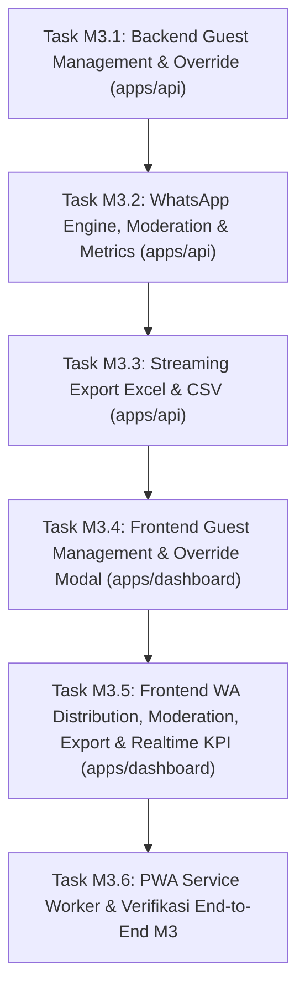

# Panduan Eksekusi Milestone M3 (Step-by-Step Prompt & Action Guide)

Dokumen ini adalah buku panduan operasional untuk mengeksekusi **Milestone M3: Dashboard Host PWA, Distribusi WhatsApp & Ekspor Laporan** dari [IMPLEMENTATION_PLAN.md](file:///c:/Users/Ridzuan/Documents/Naridza Studio/dev/inveetabynrdz/inveeta/docs/IMPLEMENTATION_PLAN.md).

Panduan ini membagi M3 menjadi **6 Task Sekuensial**. Untuk tiap task, terdapat panduan apa yang perlu Anda lakukan secara manual, dan **Prompt Siap Pakai** yang dapat langsung Anda berikan kepada Antigravity.

---

## Ringkasan Alur Eksekusi M3



---

## 👥 Task M3.1: Backend Manajemen Tamu, Alokasi Sesi & Manual Override (`apps/api`)

### 1. Tindakan Manual Anda:
- Pastikan Docker container PostgreSQL masih berjalan di komputer Anda.

### 2. Prompt untuk Antigravity:
```text
Jalankan Task M3.1: Implementasi API Manajemen Tamu, Alokasi Sesi, dan Manual Override di apps/api.
Sesuai TDD §5.2.B.3, §11.3, dan Aturan AGENTS.md:
1. Buat service tamu di apps/api/src/modules/guests/service.ts:
   - getGuestsByEvent(eventId, { search, category, rsvpStatus, page, limit }): Query paginasi tamu dengan filter dinamis, join ke allocations dan rsvps.
   - createGuest(eventId, input):
     * Validasi nomor WhatsApp (format E.164 +62).
     * Bangkitkan token unik CSPRNG 128-bit via generateGuestToken() dari @inveeta/shared.
     * Insert ke tabel guests dan insert alokasi sesi ke guestSessionAllocations secara atomik dalam db.transaction().
   - updateGuest(guestId, eventId, input): Update nama, phone, kategori, maxPax, dan perbarui alokasi sesi.
   - deleteGuest(guestId, eventId): Hapus tamu (cascade otomatis ke alokasi dan rsvps).
   - manualOverrideRsvp(guestId, eventId, input):
     * Evaluasi actualPax <= guest.maxPax.
     * Upsert ke tabel rsvps dengan isManualOverride = true, simpan overrideNotes dan waktu update.
     * Pancarkan event 'rsvp.updated' dan 'metrics.updated' ke AppEventBus.
2. Buat sub-router Hono di apps/api/src/modules/guests/routes.ts dengan guard requireAuth dan requireEventOwner:
   - GET /api/v1/manage/events/:id/guests
   - POST /api/v1/manage/events/:id/guests
   - PUT /api/v1/manage/events/:id/guests/:guestId
   - DELETE /api/v1/manage/events/:id/guests/:guestId
   - PATCH /api/v1/manage/events/:id/guests/:guestId/override
3. Mount rute tamu ke apps/api/src/index.ts menggunakan method chaining.
4. Jalankan pnpm turbo typecheck untuk memvalidasi tipe RPC.
```

### 3. Apa yang Dilakukan Antigravity:
- Membangun operasi CRUD tamu dengan validasi alokasi sesi.
- Mengimplementasikan fitur override manual dengan row-locking dan pencatatan audit.
- Memancarkan perubahan ke realtime Event Bus agar dashboard sinkron seketika.

### 4. Kriteria Selesai (DoD M3.1):
- Endpoint CRUD tamu dan override status kehadiran siap digunakan dan terproteksi kepemilikan acara.
- Typecheck monorepo lolos 100%.

---

## 💬 Task M3.2: WhatsApp Engine, Moderasi Ucapan & Agregasi Metrik (`apps/api`)

### 1. Tindakan Manual Anda:
- **Tidak ada** (100% otomatis digenerate oleh Antigravity).

### 2. Prompt untuk Antigravity:
```text
Jalankan Task M3.2: Implementasi Modul WhatsApp Template, Moderasi Ucapan, dan Metrik Dashboard di apps/api.
Sesuai TDD §5.2.B.4, §5.2.B.5, §5.2.B.8, §11.4, §11.5, dan AGENTS.md:
1. Modul WhatsApp di apps/api/src/modules/whatsapp/:
   - GET /api/v1/manage/events/:id/wa-template: Ambil template pesan acara (atau fallback default).
   - PUT /api/v1/manage/events/:id/wa-template: Simpan template pesan kustom Host.
   - GET /api/v1/manage/events/:id/guests/:guestId/wa-link:
     * Normalisasi nomor telepon via normalizeWhatsAppNumber() -> format 628...
     * Lakukan substitusi variabel template: {nama}, {acara}, {tanggal}, {link}.
     * Lakukan encodeURIComponent() dan bentuk URL: https://wa.me/628...?text=...
2. Modul Moderasi Ucapan di apps/api/src/modules/wishes/manage.routes.ts:
   - GET /api/v1/manage/events/:id/wishes/manage: Ambil seluruh ucapan untuk Host (termasuk isHidden = true) dengan filter status dan paginasi.
   - PATCH /api/v1/manage/events/:id/wishes/:wishId/visibility: Toggle isHidden (Soft Moderation) dan pancarkan event 'wish.moderated' via AppEventBus -> SSE Hub.
   - DELETE /api/v1/manage/events/:id/wishes/:wishId: Hapus permanen dari database (Hard Delete) dan pancarkan event 'wish.deleted' via AppEventBus.
3. Modul Agregasi Metrik di apps/api/src/modules/metrics/:
   - GET /api/v1/manage/events/:id/metrics: Hitung total tamu diundang, total kuota pax, jumlah pax hadir, pax tidak hadir, pax pending, breakdown per sesi acara, dan total ucapan diterima.
4. Mount seluruh rute ke apps/api/src/index.ts menggunakan method chaining.
5. Jalankan pnpm turbo typecheck.
```

### 3. Apa yang Dilakukan Antigravity:
- Membangun generator deep-link WhatsApp dengan sanitasi nomor internasional dan substitusi variabel dinamis.
- Mengimplementasikan moderasi ucapan (soft hide & hard delete) yang langsung tersinkronisasi ke browser tamu secara realtime.
- Menyediakan endpoint agregasi KPI untuk dashboard Host.

### 4. Kriteria Selesai (DoD M3.2):
- Endpoint template WhatsApp, deep-link `wa.me`, moderasi ucapan, dan KPI metrics berfungsi optimal.
- Seluruh tipe terekspor di `AppType`.

---

## 📊 Task M3.3: Streaming Ekspor Data Rekap Excel (.xlsx) & CSV (`apps/api`)

### 1. Tindakan Manual Anda:
- **Tidak ada** (100% otomatis digenerate oleh Antigravity).

### 2. Prompt untuk Antigravity:
```text
Jalankan Task M3.3: Implementasi Streaming Writer Ekspor Excel (.xlsx) dan CSV di apps/api.
Sesuai TDD §5.2.B.7, §11.6, dan Aturan Kritis AGENTS.md (Jebakan 5: Anti Memory Heap Spike pada VPS 1–2 GB):
1. Pasang dependensi exceljs di apps/api jika belum terpasang.
2. Buat service ekspor di apps/api/src/modules/exports/service.ts:
   - exportToExcelStream(eventId, resStream):
     * Gunakan mode STREAMING: const workbook = new ExcelJS.stream.xlsx.WorkbookWriter({ stream: passThroughStream }).
     * Tambahkan worksheet 'Rekap Tamu & RSVP'.
     * Definisikan kolom (12 kolom lengkap): No, Nama Tamu, Kategori, No WhatsApp, Kuota Max Pax, Sesi Alokasi, Status RSVP, Actual Pax, Catatan, Override Host, Tautan Undangan, Waktu Konfirmasi.
     * Format header: Font bold, fill warna tema, teks rata tengah.
     * Lakukan streaming baca tamu dari database via kursor Drizzle, lalu commit baris per baris: worksheet.addRow(...).commit().
     * Commit worksheet dan workbook secara asinkron.
   - exportToCsvStream(eventId):
     * Hasilkan stream teks CSV dengan menyisipkan karakter UTF-8 Byte Order Mark ('\uFEFF') di awal file agar rapi saat dibuka di Microsoft Excel Windows.
3. Buat sub-router di apps/api/src/modules/exports/routes.ts dengan guard requireAuth dan requireEventOwner:
   - GET /api/v1/manage/events/:id/export/xlsx: Return header Content-Type openxmlformats-officedocument.spreadsheetml.sheet dan attachment filename 'rekap-tamu-[slug].xlsx'.
   - GET /api/v1/manage/events/:id/export/csv: Return c.streamText() dengan Content-Type text/csv; charset=utf-8.
4. Mount ke apps/api/src/index.ts menggunakan method chaining.
5. Jalankan pnpm turbo typecheck.
```

### 3. Apa yang Dilakukan Antigravity:
- Menerapkan streaming writer Excel via `ExcelJS.stream.xlsx.WorkbookWriter` untuk konsumsi RAM konstan (< 5 MB) tanpa lonjakan heap memori (Jebakan 5).
- Menambahkan penyisipan UTF-8 BOM pada ekspor CSV untuk kompatibilitas sempurna Excel.

### 4. Kriteria Selesai (DoD M3.3):
- Request `GET .../export/xlsx` mengalirkan binary file spreadsheet yang dapat dibuka tanpa corrupt.
- Request `GET .../export/csv` mengalirkan file CSV berformat UTF-8 rapi.

---

## 📋 Task M3.4: Frontend Dashboard: Tabel Tamu, Alokasi Sesi & Modal Override (`apps/dashboard`)

### 1. Tindakan Manual Anda:
- Pastikan backend `apps/api` dan frontend `apps/dashboard` berjalan (`pnpm dev`).

### 2. Prompt untuk Antigravity:
```text
Jalankan Task M3.4: Implementasi Halaman Manajemen Tamu, Form Alokasi Sesi, dan Modal Manual Override di apps/dashboard.
Sesuai PRD §2.4, TDD §3.4, §11.3, dan AGENTS.md:
1. Buat TanStack Query hooks di src/features/guests/api/useGuests.ts:
   - useGuestsQuery(eventId, filters): Fetch daftar tamu dengan auto-caching.
   - useCreateGuestMutation(): Tambah tamu baru.
   - useUpdateGuestMutation(): Edit data tamu & alokasi.
   - useDeleteGuestMutation(): Hapus tamu.
   - useOverrideRsvpMutation(): Override status RSVP.
2. Buat komponen antarmuka tamu di src/features/guests/components/:
   - GuestListPage:
     * Search bar pencarian nama/telepon.
     * Filter tab status: Semua, Hadir, Tidak Hadir, Belum Konfirmasi.
     * Filter dropdown kategori: VIP, Keluarga, Reguler.
     * Tabel tamu responsif: Nama, Kategori (badge), Sesi Dialokasikan, Kuota Pax, Status RSVP (badge warna), Aksi.
     * Paginasi navigasi.
   - GuestFormModal: Modal tambah/edit tamu dengan input nama, nomor HP WhatsApp, pilihan kategori, kuota maxPax (1–20), dan checkbox alokasi sesi acara yang tersedia.
   - ManualOverrideModal: Modal khusus Host untuk mengubah status kehadiran tamu secara manual (Hadir / Tidak Hadir / Pending), input jumlah actualPax, catatan alasan override, dan indikator kunci form.
   - DeleteGuestDialog: Modal konfirmasi hapus tamu.
3. Hubungkan halaman tamu ke navigasi sidebar/navbar dashboard di src/App.tsx.
4. Jalankan pnpm turbo typecheck monorepo.
```

### 3. Apa yang Dilakukan Antigravity:
- Membangun tabel manajemen tamu yang interaktif dengan filter dan pencarian instan.
- Mengimplementasikan formulir alokasi sesi multi-acara per tamu.
- Mengintegrasikan modal override manual dengan feedback visual kunci formulir.

### 4. Kriteria Selesai (DoD M3.4):
- Host dapat menambah tamu baru, menentukan sesi acara apa saja yang boleh dihadiri, dan mengubah kehadiran secara manual di browser `http://localhost:5173`.
- Typecheck monorepo lulus 100%.

---

## 🚀 Task M3.5: Frontend Dashboard: Distribusi WA, Moderasi Ucapan, Ekspor & Realtime KPI (`apps/dashboard`)

### 1. Tindakan Manual Anda:
- Coba klik tombol "Kirim via WhatsApp" pada salah satu baris tamu untuk menguji pembukaan tautan WhatsApp.
- Coba klik tombol "Ekspor Excel" untuk memeriksa file unduhan di komputer Anda.

### 2. Prompt untuk Antigravity:
```text
Jalankan Task M3.5: Implementasi Distribusi WhatsApp, Moderasi Ucapan, Ekspor Laporan, dan Realtime KPI di apps/dashboard.
Sesuai PRD §2.4, TDD §3.4, §8.2, §11.4, §11.5, §11.6, dan AGENTS.md:
1. Fitur Distribusi WhatsApp di src/features/whatsapp/:
   - WaTemplateEditorModal: Editor template pesan WhatsApp Host dengan tombol sisipkan tag dinamis ({nama}, {acara}, {tanggal}, {link}) dan live preview pesan terformat.
   - Integrasikan tombol aksi di tiap baris tabel tamu:
     * Tombol 'Kirim WhatsApp': Membuka URL wa.me di tab baru.
     * Tombol 'Salin Tautan': Menyalin link undangan personal tamu ke clipboard dengan toast notifikasi.
2. Fitur Moderasi Ucapan di src/features/wishes/:
   - WishesModerationPage: Tabel daftar ucapan tamu dengan kolom Nama Pengirim, Hubungan, Pesan, Waktu, dan Status (Aktif / Disembunyikan).
   - Tombol toggle 'Sembunyikan / Tampilkan' (Soft Moderation) dan tombol 'Hapus' (Hard Delete) dengan konfirmasi.
3. Fitur Realtime KPI & Ekspor di src/features/analytics/:
   - KpiSummaryCards: Kartu ringkasan metrik statistik (Total Tamu, Total Pax Dialokasikan, Pax Hadir, Pax Tidak Hadir, Pax Belum Konfirmasi, Total Ucapan).
   - SessionAttendanceBreakdown: Grafik / progress bar persentase kapasitas kehadiran per sesi (mis. Akad vs Resepsi).
   - Hook useDashboardRealtime(eventId): Mendengarkan event SSE 'rsvp.updated' dan 'metrics.updated' -> otomatis memicu queryClient.invalidateQueries() untuk sinkronisasi state instan tanpa reload.
   - Tombol 'Ekspor Excel (.xlsx)' dan 'Ekspor CSV': Mengunduh file laporan tamu langsung dari endpoint streaming API.
4. Jalankan pnpm turbo typecheck monorepo.
```

### 3. Apa yang Dilakukan Antigravity:
- Membangun antarmuka distribusi WhatsApp dengan tombol direct-share satu-klik.
- Membangun panel moderasi ucapan untuk keamanan konten.
- Mengintegrasikan dashboard KPI dengan SSE listener untuk pembaruan kartu statistik secara live saat tamu submit RSVP.
- Menghubungkan tombol download ekspor Excel & CSV.

### 4. Kriteria Selesai (DoD M3.5):
- Klik tombol WhatsApp membuka deep-link `wa.me` dengan teks dan tautan personal terisi sempurna.
- Kartu KPI terupdate otomatis saat ada RSVP baru masuk.
- File rekap tamu `.xlsx` dan `.csv` terunduh dengan sukses.

---

## 📱 Task M3.6: PWA Service Worker & Verifikasi End-to-End Milestone M3 (`apps/dashboard`)

### 1. Tindakan Manual Anda:
- Buka dashboard di Google Chrome / Microsoft Edge di laptop Anda, periksa apakah muncul ikon "Install App" di address bar browser untuk menguji kapabilitas PWA.

### 2. Prompt untuk Antigravity:
```text
Jalankan Task M3.6: Konfigurasi PWA Service Worker dan Verifikasi Menyeluruh Milestone M3.
Sesuai TDD Bagian 3.4 & Bagian 14:
1. Konfigurasi vite-plugin-pwa di apps/dashboard/vite.config.ts:
   - Setup Web App Manifest: name ('Inveeta Dashboard'), short_name ('Inveeta'), theme_color ('#4F46E5'), background_color ('#FFFFFF'), display ('standalone'), icons (192x192, 512x512).
   - Setup Service Worker dengan runtime caching untuk static assets dan offline fallback screen di public/offline.html.
2. Buat komponen OfflineBanner yang memberi tahu Host saat koneksi internet terputus.
3. Jalankan pipeline verifikasi monorepo secara penuh:
   pnpm turbo lint typecheck build
4. Uji alur lengkap Host di dashboard:
   - Tambah 3 tamu dengan kategori berbeda.
   - Ubah status RSVP tamu secara manual via modal override.
   - Sembunyikan salah satu ucapan di panel moderasi.
   - Unduh rekap Excel dan pastikan kolom sesuai spesifikasi.
5. Laporkan status pemenuhan Definition of Done (DoD) Milestone M3.
```

### 3. Apa yang Dilakukan Antigravity:
- Mengonfigurasi kapabilitas Progressive Web App (PWA) agar dashboard dapat diinstal di homescreen HP/desktop.
- Menyiapkan layar offline fallback yang elegan saat koneksi seluler drop di gedung pernikahan.
- Memverifikasi build dan typecheck seluruh monorepo monolitik.

### 4. Kriteria Selesai (DoD M3.6 / Final Milestone M3):
* Host dapat mengelola ratusan tamu, mengalokasikan sesi berbeda, dan mengunduh rekap Excel rapi tanpa lonjakan memori.
* Host dapat melakukan override status kehadiran tamu dan form personal terkunci otomatis.
* Tombol WhatsApp menghasilkan pesan terformat siap kirim.
* Dashboard dapat diinstal sebagai PWA dan memiliki layar offline.
* Seluruh monorepo lulus `turbo typecheck build` 100%.
* Milestone M3 selesai 100%, siap melangkah ke **Milestone M4: Hardening, Load Test & Produksi v1.0**!
