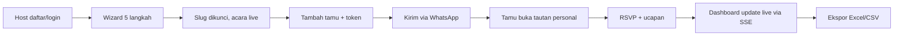
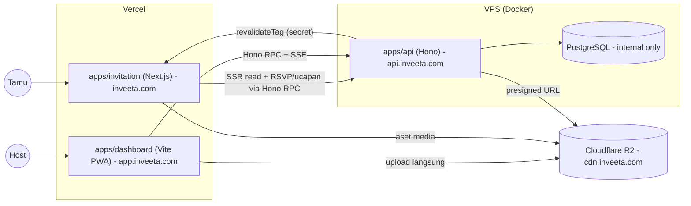

# PRD — Inveeta (Event-Tech Platform) MVP

| Atribut | Nilai |
|---|---|
| Versi | 0.3 |
| Tanggal | 13 Oktober 2026 |
| Pemilik | Naridza Studio (solo developer) |
| Status | Approved |
| Sumber | [catatanawalinveeta.md](./catatanawalinveeta.md) |

---

## 1. Executive Summary

### 1.1 Problem Statement
Pasangan yang akan menikah butuh undangan digital yang personal (per tamu), mudah dibagikan via WhatsApp, dan bisa merekap RSVP secara akurat. Solusi yang ada umumnya dikerjakan manual oleh vendor, tidak self-service, dan tidak memberi kontrol data tamu (kuota pax, sesi, status RSVP) secara real-time kepada pemilik acara.

### 1.2 Proposed Solution
Inveeta adalah platform self-service tempat pemilik acara membuat undangan digital berbasis template dalam satu wizard, mengelola tamu dengan tautan personal bertoken, lalu memantau RSVP dan ucapan secara live dari Dashboard PWA. Dibangun sebagai **Decoupled Monolith dalam Monorepo TypeScript** sehingga satu developer dapat memelihara seluruh sistem dan menambah modul Phase 2 (scanner, live display, photobooth) tanpa refactor.

### 1.3 Success Criteria (KPI MVP)
| # | KPI | Target |
|---|---|---|
| 1 | Waktu pemilik dari registrasi hingga undangan live | ≤ 15 menit (median) |
| 2 | Performa halaman undangan (mobile, 4G) | LCP ≤ 2,5 s; Lighthouse Performance ≥ 90 |
| 3 | Kapasitas | 50 acara aktif/bulan; puncak 2.000 pembukaan undangan per acara tanpa error 5xx |
| 4 | Akurasi RSVP | 0 kasus RSVP melebihi kuota pax atau masuk setelah batas waktu |
| 5 | Preview WhatsApp | 100% tautan undangan menampilkan Open Graph (judul, gambar, deskripsi) yang benar |
| 6 | Timeline | MVP rilis produksi dalam 3 bulan |

---

## 2. User Experience & Functionality

### 2.1 User Personas
| Persona | Deskripsi | Kebutuhan Utama |
|---|---|---|
| **Pemilik Acara (Host)** | Calon pengantin / keluarga, 22–40 th, mobile-first, non-teknis | Buat undangan cepat, kelola tamu, kirim via WhatsApp, pantau RSVP |
| **Tamu (Guest)** | Penerima undangan, segala usia, membuka dari WhatsApp di ponsel | Lihat info acara, konfirmasi kehadiran, kirim ucapan, navigasi ke lokasi |
| **Developer/Operator** | Solo developer (Naridza Studio) | Menambah template via kode, operasi via DB/script, deploy sederhana |

### 2.2 Modul & User Stories

#### Modul A — Inisiasi Acara (Self-Service)

**A1. Autentikasi**
> Sebagai Host, saya ingin mendaftar/login dengan Email+Password atau Google agar bisa mulai membuat acara.

- AC:
  - Registrasi & login via Email+Password (dengan verifikasi email dan reset password; email dikirim via Resend).
  - Sign in with Google (OAuth 2.0); akun dengan email sama digabung (account linking).
  - Diimplementasikan dengan **Better Auth** (adapter Drizzle, di-mount pada Hono).
  - Sesi bertahan di PWA (persistent session, cookie HttpOnly di `.inveeta.com`) hingga logout atau kedaluwarsa.

**A2. Multi-Step Wizard**
> Sebagai Host, saya ingin mengisi data acara langkah demi langkah agar tidak kewalahan.

- AC:
  - Langkah: (1) Info Dasar → (2) Waktu & Sesi → (3) Lokasi → (4) Aset Media & Rekening → (5) Kustomisasi Visual.
  - Validasi per langkah memakai skema Zod yang sama di client & server.
  - Progres tersimpan (draft) per langkah sehingga Host bisa melanjutkan nanti; acara belum dipublikasikan sebelum wizard selesai.
  - Mendukung lebih dari satu sesi (mis. Akad, Resepsi) dengan waktu & lokasi masing-masing. Setiap sesi memiliki flag **"Tampil di tautan publik"** (on/off).

**A3. Slug URL**
> Sebagai Host, saya ingin URL undangan yang mudah diingat.

- AC:
  - Slug digenerate otomatis dari nama acara; dapat dikustomisasi.
  - Cek ketersediaan langsung (debounced) dengan feedback tersedia/terpakai.
  - Format: huruf kecil, angka, tanda hubung; panjang 3–60 karakter; daftar kata terlarang (reserved words seperti `api`, `admin`, `app`, `cdn`, `_next`, `privacy`, `terms`) karena undangan dilayani di root domain `inveeta.com/{slug}`.
  - Slug **immutable** setelah disimpan (tidak bisa diubah via UI maupun API).

**A4. Siklus Hidup Acara**
> Sebagai Host, saya ingin undangan langsung aktif setelah selesai wizard.

- AC:
  - Single-state: acara langsung **live** begitu wizard selesai. Tidak ada status draft/publish/arsip di MVP (selain draft wizard internal).

**A5. Kustomisasi Template (Schema-Driven)**
> Sebagai Host, saya ingin memilih template dan menyesuaikan tampilan.

- AC:
  - Setiap template didefinisikan oleh skema (registry di kode) yang menentukan: daftar section, kuota foto, slot media, opsi warna, dan `tier`.
  - Unggah foto: kuota sesuai template, maks **2 MB per foto** (format JPG/PNG/WebP).
  - Unggah musik latar sendiri: format **MP3/M4A, maks 10 MB** (divalidasi client & server).
  - Kustomisasi warna dasar dan urutan section (drag/reorder) dalam batas yang diizinkan skema.
  - Ganti template di kemudian hari hanya ke template dengan `tier` yang sama. Di MVP semua template satu tier (gratis), tetapi aturan tetap ditegakkan di level data.

#### Modul B — Undangan Digital (Guest-Facing)

**B1. Cover & Audio**
> Sebagai Tamu, saya ingin membuka undangan dengan pengalaman yang berkesan.

- AC:
  - Cover pembuka dengan tombol "Buka Undangan" yang memicu pemutaran musik (memenuhi kebijakan autoplay browser).
  - Floating player play/pause; posisi audio dipertahankan saat dijeda.

**B2. Tautan Publik vs Personal**
> Sebagai Host, saya ingin satu tautan umum untuk dibagikan luas dan tautan personal untuk tamu terdaftar.

- AC:
  - Tautan publik (`inveeta.com/{slug}`) → menampilkan undangan; **form RSVP nonaktif**; hanya menampilkan sesi yang ditandai Host "Tampil di tautan publik".
  - Tautan personal (`inveeta.com/{slug}/{token}`) → memuat nama tamu dan mengaktifkan RSVP.
  - Token acak unik, tidak dapat ditebak (≥ 128-bit entropy), tidak mengekspos ID internal.
  - Token tidak valid → fallback ke tampilan publik.

**B3. Multi-Sesi Terfilter**
- AC: Tamu personal hanya melihat sesi yang dialokasikan kepadanya.

**B4. RSVP**
> Sebagai Tamu, saya ingin mengonfirmasi kehadiran dan jumlah orang yang datang.

- AC:
  - Pilihan: Hadir / Tidak Hadir; jumlah pax 1..kuota maksimal tamu (divalidasi di server).
  - Tamu dapat mengubah konfirmasi berkali-kali sebelum batas waktu.
  - Form terkunci otomatis setelah batas waktu (tanggal & jam, zona waktu acara) — ditegakkan di server, bukan hanya UI.

**B5. Buku Ucapan**
- AC:
  - Ucapan langsung tayang tanpa approval.
  - Muncul live untuk pengunjung lain dan di dashboard (via SSE).
  - Host dapat menyembunyikan atau menghapus ucapan dari dashboard.
  - Proteksi spam dasar: rate limit per IP/token dan batas panjang teks.

**B6. Amplop Digital & Kado**
- AC:
  - Multi rekening bank / e-wallet dengan tombol salin nomor.
  - Satu gambar QRIS statis.
  - Alamat kado fisik dengan tombol salin.
  - Bersifat informatif; tidak ada unggah bukti transfer.

**B7. Navigasi & Kalender**
- AC: Tombol ke Google Maps, Waze, dan "Add to Google Calendar" (URL template) per sesi.

**B8. Open Graph WhatsApp Preview**
- AC:
  - Setiap URL undangan (publik & personal) dirender server-side dengan meta OG dinamis (judul acara, tanggal, gambar cover).
  - Gambar OG ≤ 300 KB, rasio 1.91:1, agar tampil di WhatsApp.

#### Modul C — Dashboard PWA Host

**C1. PWA**
- AC:
  - Installable (manifest + Service Worker) di Android/iOS.
  - Saat offline, tampil halaman statis "Tidak Ada Koneksi Internet". Tidak ada sinkronisasi data offline di MVP.

**C2. Metrik Utama**
- AC: Kartu Total Tamu Diundang, Status RSVP (Hadir / Tidak Hadir / Pending) beserta total pax hadir, Total Ucapan. Update live via SSE.

**C3. Manajemen Tamu**
- AC:
  - Entri tamu satuan: Nama, Nomor WhatsApp, Kategori (VIP / Keluarga / Reguler), Kuota Maks Pax, centang alokasi sesi.
  - Token unik digenerate otomatis per tamu.
  - Edit & hapus tamu.

**C4. Filter & Manual Override**
- AC: Cari nama; filter kategori & status RSVP; Host dapat mengubah status RSVP dan jumlah hadir secara manual (tercatat sebagai perubahan oleh Host).

**C5. Distribusi Undangan**
- AC:
  - Template pesan WhatsApp dapat disunting dengan variabel dinamis (mis. `{nama}`, `{link}`, `{acara}`, `{tanggal}`).
  - Per tamu: tombol "Kirim ke WhatsApp" (deep link `wa.me` dengan pesan terisi) dan "Salin Pesan".

**C6. Ekspor Data**
- AC: Unduh rekap tamu + ringkasan metrik dalam format Excel (.xlsx) atau CSV.

### 2.3 User Flow Utama



### 2.4 Non-Goals (MVP)
- Monetisasi, paket berbayar, payment gateway (seluruh fitur gratis di MVP).
- Super Admin panel (operasi via DB/script; template ditambah via kode).
- Template builder visual / editor bebas (drag-and-drop desain).
- Import tamu massal (CSV/Excel) — hanya entri satuan.
- Pengiriman WhatsApp otomatis via API (WABA/broadcast); hanya deep link manual.
- Verifikasi/unggah bukti transfer amplop digital.
- Status siklus hidup acara (draft/arsip/unpublish) dan perubahan slug.
- Multi-user/kolaborator per acara.
- Jenis acara selain pernikahan (skema dibuat generik, tetapi tidak diuji/dipasarkan).
- Modul Phase 2: scanner check-in, live display, photobooth.
- Multi-bahasa (UI Bahasa Indonesia saja).

---

## 3. AI System Requirements
Tidak berlaku untuk MVP.

---

## 4. Technical Specifications

> Level gambaran umum. Detail (skema tabel, kontrak endpoint, strategi caching) akan dijabarkan di TDD.

### 4.1 Architecture Overview — Decoupled Monolith + Monorepo

Satu backend API (monolith modular per domain) melayani beberapa frontend yang terpisah (decoupled). Seluruh kode TypeScript dalam satu monorepo agar tipe, skema validasi, dan kontrak API dibagi tanpa duplikasi.

**Monorepo Engine:** pnpm Workspaces + Turborepo (task pipeline & caching build/lint/typecheck).

```
inveeta/
├── apps/
│   ├── invitation/     # Next.js (App Router) — undangan publik, SSR/SSG + OG dinamis
│   ├── dashboard/      # Vite + React PWA — dashboard Host (client-side)
│   ├── api/            # Node.js + Hono — REST + Hono RPC + SSE
│   ├── scanner/        # [Phase 2] PWA offline-first (IndexedDB)
│   ├── live-display/   # [Phase 2] layar live (WebSocket)
│   └── photobooth/     # [Phase 2] upload via R2 presigned URL
├── packages/
│   ├── db/             # Drizzle ORM: schema, migrations, client
│   ├── shared/         # Zod schemas, DTO, konstanta, util
│   └── config/         # (opsional) tsconfig, eslint, tailwind preset bersama
├── turbo.json
└── pnpm-workspace.yaml
```

| Komponen | Teknologi | Peran |
|---|---|---|
| `apps/invitation` | Next.js App Router | Render undangan dengan ISR on-demand (`revalidateTag`); seluruh data (SSR read & aksi tamu RSVP/ucapan) via API (Hono RPC); `generateMetadata` untuk OG WhatsApp |
| `apps/dashboard` | Vite + React + PWA (Service Worker) | Wizard, manajemen tamu, metrik live, ekspor. Fallback offline statis |
| `apps/api` | Node.js + Hono | Business logic, auth (Better Auth), validasi Zod, SSE, presigned upload R2, trigger revalidasi. Folder modular per domain. Mengekspor `AppType` untuk Hono RPC client |
| `packages/db` | PostgreSQL + Drizzle ORM | Single source of truth skema & migrasi |
| `packages/shared` | Zod + TypeScript | Skema validasi & DTO yang dipakai API dan semua frontend |
| Storage | Cloudflare R2 | Foto, musik, QRIS, gambar OG. Zero egress; upload langsung dari client via presigned URL |
| Realtime | SSE (MVP), WebSocket (Phase 2) | SSE: ucapan live & metrik dashboard. WebSocket disiapkan untuk live-display/scanner |

**Struktur domain `apps/api` (usulan):**
`auth`, `events` (wizard, slug, sesi), `templates` (registry & validasi kustomisasi), `guests` (CRUD, token), `rsvp`, `wishes` (ucapan + moderasi), `media` (presigned R2), `exports`, `realtime` (SSE hub). Setiap modul berisi route, service, dan repository sendiri; komunikasi antar modul lewat service, bukan akses tabel langsung.

**Alur data utama:**



### 4.2 Integration Points
| Integrasi | Keterangan |
|---|---|
| **Auth** | **Better Auth** di-mount pada Hono (`api.inveeta.com`): Email+Password, Google OAuth, account linking, adapter Drizzle. Session cookie `HttpOnly` di `.inveeta.com` dibagi `app.` dan `api.` |
| **Hono RPC** | `hc<AppType>` di dashboard & invitation (SSR read + aksi tulis) sebagai type-safe client tanpa codegen |
| **PostgreSQL** | Diakses **hanya** oleh `apps/api` (read/write, pemilik migrasi). Frontend tidak pernah terhubung langsung ke DB |
| **Revalidasi** | API memanggil route handler revalidate di `apps/invitation` (`revalidateTag`, dilindungi secret) setiap data acara/sesi/tamu/ucapan berubah |
| **Cloudflare R2** | S3-compatible API; presigned PUT untuk upload, custom domain `cdn.inveeta.com` untuk serving |
| **Email** | Resend — verifikasi email & reset password (dipicu Better Auth) |
| **WhatsApp** | Deep link `https://wa.me/{nomor}?text={pesan}`; tidak ada integrasi API resmi |
| **Google Maps / Waze / Google Calendar** | URL template, tanpa API key |

### 4.3 Deployment (Gambaran)
- **Domain:** `inveeta.com` → `apps/invitation`; `app.inveeta.com` → `apps/dashboard`; `api.inveeta.com` → `apps/api`; `cdn.inveeta.com` → R2.
- **Frontend:** `apps/invitation` dan `apps/dashboard` di Vercel (dua project dari monorepo yang sama).
- **Backend:** `apps/api` + PostgreSQL di VPS menggunakan Docker (Compose); Postgres hanya di network internal. Reverse proxy + TLS (mis. Caddy/Nginx).
- **Storage:** Cloudflare R2 + custom domain `cdn.inveeta.com`.
- **Email:** Resend dengan domain terverifikasi (SPF/DKIM) `inveeta.com`.
- **CI:** Turborepo pipeline (lint, typecheck, test, build) dengan remote cache; migrasi Drizzle dijalankan saat deploy API.
- Backup PostgreSQL terjadwal harian (retensi ≥ 7 hari).

### 4.4 Non-Functional Requirements
| Area | Target |
|---|---|
| Performa undangan | LCP ≤ 2,5 s di mobile 4G; halaman cacheable (SSG/ISR) |
| Latensi API | p95 ≤ 300 ms untuk endpoint RSVP & ucapan |
| Kapasitas | 2.000 pembukaan undangan per acara pada jam puncak; ≥ 200 koneksi SSE simultan |
| Ketersediaan | ≥ 99,5% uptime bulanan |
| Media | Foto ≤ 2 MB (divalidasi client & server via presigned constraint); optimasi gambar saat serving |
| Aksesibilitas | Halaman undangan Lighthouse Accessibility ≥ 90 |
| Type-safety | 0 duplikasi skema validasi; semua input API divalidasi Zod dari `packages/shared` |

### 4.5 Security & Privacy
- Data pribadi tamu (nama, nomor WhatsApp) hanya dapat diakses Host pemilik acara; otorisasi berbasis kepemilikan di setiap endpoint.
- Token tamu acak kriptografis; endpoint publik tidak pernah mengembalikan nomor WhatsApp atau data tamu lain.
- Rate limiting pada login, RSVP, ucapan, dan cek slug.
- Cookie session `HttpOnly`, `Secure`, `SameSite=Lax` dengan domain `.inveeta.com`; CORS dibatasi ke origin resmi (`inveeta.com`, `app.inveeta.com`).
- PostgreSQL hanya dapat diakses dari jaringan internal Docker (tidak ada port publik); satu-satunya klien DB adalah `apps/api`. Endpoint publik untuk SSR undangan hanya mengembalikan field non-sensitif (tanpa nomor WhatsApp).
- Endpoint revalidate Next.js dilindungi shared secret; hanya dipanggil oleh API.
- Presigned URL R2 berumur pendek (≤ 10 menit) dengan batas content-type & ukuran.
- Sanitasi teks ucapan (cegah XSS).
- Kepatuhan UU Pelindungan Data Pribadi (UU PDP) Indonesia: kebijakan privasi, hak hapus akun & data acara.

### 4.6 Kesiapan Phase 2 (Tanpa Refactor)
| Modul | Kesiapan yang dibangun di MVP |
|---|---|
| `apps/scanner` (PWA offline-first, IndexedDB) | Token tamu sudah unik & dapat dipakai sebagai payload QR; skema tamu menyediakan ruang untuk status check-in; DTO di `packages/shared` |
| `apps/live-display` (WebSocket) | Modul `realtime` di API dirancang dengan abstraksi event bus sehingga transport SSE → WebSocket dapat ditambah berdampingan |
| `apps/photobooth` (R2 presigned upload) | Modul `media` dengan presigned upload sudah generik (scope per acara & jenis aset) |
| Monetisasi | Field `tier` pada template & acara sudah ada; modul `billing` dapat ditambah sebagai domain baru di API |

Prinsip: setiap app baru hanya bergantung pada `packages/shared`, `packages/db` (via API), dan `AppType` Hono RPC — tidak ada perubahan struktur pada app yang sudah ada.

---

## 5. Risks & Roadmap

### 5.1 Phased Rollout
| Fase | Durasi | Cakupan |
|---|---|---|
| **M0 — Fondasi** | Minggu 1–2 | Setup monorepo (pnpm + Turborepo), `packages/db`, `packages/shared`, skeleton Hono + RPC, auth, CI, deploy pipeline VPS & Vercel |
| **M1 — Inisiasi Acara** | Minggu 3–5 | Wizard 5 langkah, slug, template registry (min. 2–3 template), upload R2 |
| **M2 — Undangan** | Minggu 6–8 | Next.js undangan, OG dinamis, tautan publik/personal, RSVP, ucapan, amplop, navigasi |
| **M3 — Dashboard** | Minggu 9–11 | PWA, metrik + SSE, manajemen tamu, filter/override, distribusi WA, ekspor |
| **M4 — Hardening & Launch** | Minggu 12 | Load test (2.000 open/acara), security review, backup, beta dengan 3–5 acara nyata |
| **v1.1** | Pasca-MVP | Import tamu massal, Super Admin panel minimal, monetisasi/tier + payment gateway |
| **v2.0** | Phase 2 | `apps/scanner`, `apps/live-display`, `apps/photobooth`, jenis acara lain |

### 5.2 Technical Risks
| Risiko | Dampak | Mitigasi |
|---|---|---|
| Bus factor solo developer & scope creep | Tinggi | Non-Goals ketat; milestone mingguan; reuse skema via `packages/shared` |
| Cookie/session lintas subdomain (Vercel ↔ VPS) | Sedang | Cookie Better Auth di `.inveeta.com`; `SameSite=Lax`; CORS hanya `app.inveeta.com` & `inveeta.com` |
| Latensi SSR undangan karena hop tambahan Vercel → API (VPS) | Rendah | Halaman di-cache ISR sehingga API hanya dipanggil saat revalidate/cache miss; endpoint publik ringan; region Vercel dekat VPS |
| Gagal revalidate (webhook API → Next.js) → undangan menampilkan data lama | Rendah–Sedang | Retry dengan backoff; fallback time-based revalidate panjang (mis. 1 jam); endpoint revalidate dilindungi secret |
| Lonjakan traffic undangan saat dibagikan massal | Sedang | ISR on-demand + CDN Vercel; API hanya diakses saat cache miss atau aksi tamu; R2 untuk aset |
| VPS single point of failure (API + DB) | Sedang | Backup harian, health check & auto-restart container, rencana restore teruji |
| Batas koneksi SSE pada VPS/reverse proxy | Rendah–Sedang | Konfigurasi keep-alive & timeout proxy; heartbeat; fallback polling |
| Konsistensi data RSVP (race condition saat ubah berkali-kali) | Rendah | Validasi kuota & deadline di server dalam transaksi DB |
| Kompatibilitas PWA iOS (install, Service Worker) | Rendah | Uji di Safari iOS; fitur offline hanya halaman fallback |
| Biaya/kebijakan pihak ketiga (Vercel, R2, email) | Rendah | Pantau kuota free tier; abstraksi provider email & storage |

### 5.3 Decision Log (Resolved, 13 Okt 2026)
| # | Topik | Keputusan |
|---|---|---|
| 1 | Library auth | **Better Auth** (Email+Password, Google OAuth, account linking, adapter Drizzle, di-mount di Hono) |
| 1b | Strategi session | Cookie `HttpOnly` di root domain `.inveeta.com`, dibagi `app.` dan `api.` |
| 2 | Format URL personal | Path segment: `inveeta.com/{slug}/{token}` |
| 3 | Sesi di tautan publik | Host mengatur per sesi via flag "Tampil di tautan publik" |
| 4 | Data SSR `apps/invitation` | **Selalu via API** (Hono RPC). API satu-satunya yang mengakses DB; Postgres tidak diekspos ke internet. *(Direvisi dari "baca DB langsung" karena risiko keamanan.)* |
| 5 | Revalidasi halaman undangan | On-demand: API memanggil endpoint revalidate Next.js (`revalidateTag`) saat data acara/tamu berubah |
| 6 | File musik | MP3/M4A, maks 10 MB |
| 7 | Email transaksional | Resend |
| 8 | Domain | `inveeta.com` (root = undangan, `app.` = dashboard, `api.` = API, `cdn.` = R2) |

### 5.4 Open Questions (untuk TDD)
- Desain endpoint publik read-only untuk SSR undangan (payload per slug & per token, field yang diekspos).
- Struktur tag revalidasi (per acara vs per tamu) dan autentikasi endpoint revalidate.
